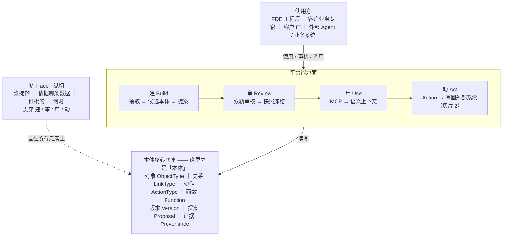
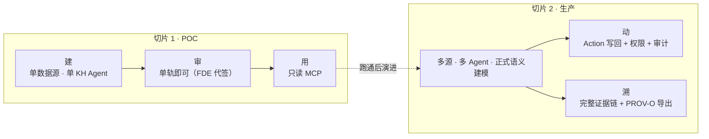
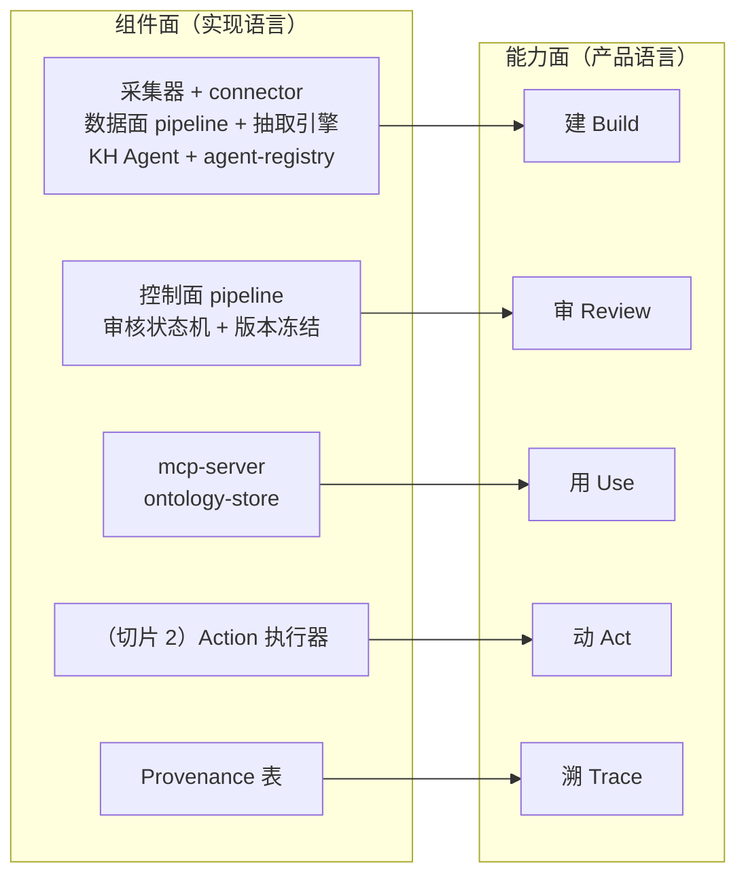

# 本体平台 · 能力面架构

> **本文视角**：从「平台对谁提供什么能力」来描述这套系统。读者是老板、客户、FDE。
> **与组件面的关系**：组件面（`2026-09-24-fde-ontology-platform-design.md` §4.1）回答「系统由哪些模块组成」，面向工程师；能力面回答「平台能做什么事」，面向业务。同一套系统，两种读法，映射见 §7。
> **本文的由来**：2026-09-24 对齐会议纪要 —— 「当前梳理的架构过于偏向底层技术实现，与本体核心逻辑关联度不足，需进一步向上抽象调整」。
> 向上抽象的落地方式只有两件事：**把主视觉从模块换成能力**，以及**把「本体核心模型」从术语表提到图的正中央**。

---

## 1. 总图

> **图注（刻意不画进主视觉）**：底座整体落在 `ontology-store` **存储抽象**上（GraphDB 实现 / RDBMS 实现 / 内存实现），**可整体替换，能力面无感**。

**读这张图的三个要点**：

1. 平台对外只有 **四件事 + 一条纵切**：建、审、用、动、溯。没有第五件。
2. `connector`、采集器、`pipeline`、抽取引擎、`agent-registry` 收进「建」，`mcp-server` 收进「用」 —— 全部收进能力内部，**主视觉上不再出现**。它们没有消失，只是不再是这张图的主角。
3. 能力下面压着的是**本体核心底座**。这才是「本体」本身；四个能力只是**操作本体的四种动作**。
   组件面图里，「本体」只以一个叫 `ontology-store` 的存储抽象出现 —— 这是上一版最被诟病的地方：**架构上讲了很多怎么把数据搬进来，几乎没讲搬进来的东西长什么样。**

---

## 2. 四个能力

每个能力都用同一套字段描述：**谁用 · 做什么 · 产出什么 · 收起来的实现 · 依赖底座什么**。
最后一项是关键 —— 它说明「能力」和「本体」的受力关系。

### 2.1 建 Build —— 让本体从客户系统里长出来

- **谁用**：FDE 工程师（客户业务专家提供输入，不直接操作）
- **做什么**：选定数据源 → 抽取结构与样本 → KH Agent 生成候选对象与关系 → 分组生成提案
- **产出**：**本体提案**（候选 ObjectType / LinkType 清单，每条带证据）
- **收起来的实现**：采集器 Collector、connector（结构化 / 非结构化 / 对话式）、数据面 pipeline、抽取引擎、KH Agent、`agent-registry`
- **依赖底座**：写入 `Proposal`；读取当前 `Version` 作为增量基线

> 会议确定的迭代方式落在这里：FDE 与客户首轮沟通 → 构建第一版 KH Agent → 抽取 → 客户确认 → FDE 调整 KH Agent → 再抽取，如此往复，直到本体收敛。**KH Agent 是被迭代的对象，不是一次性的配置。**
>
> `agent-registry` 也归这一侧 —— 它是 **KH Agent 的抽象层**（注册 / 版本 / 迭代记录），承载的就是上面那套往复。经 `mcp-server` 消费本体的**外部 Agent 走的是另一条路，不经过它**：两者名字里都有 agent，但一个是造本体的、一个是读本体的。

### 2.2 审 Review —— 结构变更由人盖章

- **谁用**：FDE（建模轨）+ 客户业务专家（业务轨）
- **做什么**：双轨并行审核 → 通过则快照冻结（轨名沿用 §3 术语表）
  - **建模轨**（FDE 审建模质量）：有哪些对象、哪些关系、基数对不对
  - **业务轨**（客户审语义正确性）：名字起得对不对、业务含义准不准
- **产出**：**冻结的本体版本** `v0.x`
- **收起来的实现**：审核状态机、版本 diff、冻结机制
- **依赖底座**：`Proposal` → `Version`；冻结后的版本不可变

> 「审」是这套系统和「让 AI 自动建图」的分界线。**Agent 是提议者，不是决定者** —— 结构变更必须有人盖章，且盖在两个不同的位置上。

### 2.3 用 Use —— 本体被消费

- **谁用**：外部 Agent（Claude Desktop / Cursor / 自研）、FDE 调试
- **做什么**：通过 MCP 查询对象、走关系、拿语义上下文
- **产出**：**Agent 可用的语义上下文** —— 这是客户真正买单的东西
- **收起来的实现**：`mcp-server`、`ontology-store`、查询引擎
- **依赖底座**：只读 `Version`，**不读未审的提案**

> 本体的价值在这个能力上兑现：不是给人看的图，是给 Agent 用的上下文。前面三个能力都是在为这里供货。

### 2.4 动 Act —— 本体驱动写回（切片 2）

- **谁用**：外部 Agent、业务系统
- **做什么**：调用 Action → 前置条件校验 → 效果写回外部系统 → 留审计
- **产出**：**外部系统的真实变更**
- **收起来的实现**：ActionType 执行器、权限、审计
- **依赖底座**：`ActionType` + 权限 + 审计策略
- **为什么现在就要画在图上**：这是「只读的知识图谱」和「运营系统」的分水岭。切片 1 不实现，**但底座里必须给它留位置**，否则切片 2 会返工重来。

---

## 3. 溯 Trace —— 唯一的纵切

`溯` 不是第五个能力，**它横跨前面四个**：不是一步操作，而是每个操作都必须写下的属性。

**每个对象类型 / 关系类型 / 动作都挂四个字段**：

- `proposed_by` —— 哪一轮、哪个 KH Agent 提出的
- `evidence` —— 依据哪条数据 / 哪次抽取（回到源证据）
- `approved_by` —— 谁批的（建模轨 / 业务轨分别记）
- `approved_at` —— 何时批的

**两条设计决定**：

1. **内部保持轻量**：自己建表，不引入 RDF / 推理栈。企业本体的实际查询深度通常 ≤ 3 跳，为「理论完备」付的代价在交付现场收不回来。
2. **出口处付审计端的钱**：对外导出时序列化为 **PROV-O**。也就是说 —— 内部是工程实现，对外是标准格式。**只在边界上做转换，不在内部做妥协。**

> 会议明确 `semantica` 偏学术化、暂不适配当前需求。这里就是取舍的具体落点：**不把 W3C 那一整套（OWL / SHACL / 确定性推理）搬进运行时，只在出口处对齐标准。**

---

## 4. 本体核心底座 —— 「本体」到底由什么构成

这是上一版架构最薄的一节，也是老板说「与本体核心逻辑关联度不足」最直接的落点。
**四根柱子 + 三件治理物**：

### 4.1 四根柱子

| 元素 | 关键字段 | 说明 |
| --- | --- | --- |
| **对象** ObjectType | `key` · `display_name` · `description` · `properties[]`（`name` / `type` / `nullable` / `is_identifier` / `source[]`） | 一个业务实体。`source[]` 指向它来自哪个系统 |
| **关系** LinkType | `key` · `source_type` · `target_type` · `cardinality` · `semantic` | `cardinality`：1:1 / 1:N / N:M。`semantic`：has / belongs_to / depends_on / … |
| **动作** ActionType | `key` · `target_object_type` · `parameters[]` · `preconditions[]` · `effects[]` · `permission` · `audit_policy` | 对本体的写入。`effects[]` 描述「写回哪个外部系统的什么」 |
| **函数** Function | `key` · `signature` · `allowed_types[]` | 派生属性 / 聚合，不改变状态 |

### 4.2 三件治理物

| 元素 | 作用 |
| --- | --- |
| **版本** Version | 快照与冻结的载体。审核通过的那一刻，产生一个不可变版本 |
| **提案** Proposal | 变更的原子单位。KH Agent 产出的是提案，不是直接改本体 |
| **证据** Provenance | 纵切（见 §3），挂在上述所有元素上 |

### 4.3 三条设计决定

1. **关系独立成表**，不做「实体 + 关系」打包。
   一旦打包，关系就无法单独携带基数、语义和证据，后面每一次查询和每一次审核都会付利息。
2. **ActionType 在切片 1 不实现，但模型必须占位。**
   纯粹为了不让切片 2 推翻切片 1 的数据结构。
3. **证据内建、格式外对齐。**
   内部表 + 出口 PROV-O 序列化，两边都要，但**只在出口处付费**。

---

## 5. 能力 × 角色

|          | 建 Build | 审 Review | 用 Use | 动 Act | 溯 Trace |
| -------- | -------- | --------- | ------ | ------ | -------- |
| FDE 工程师   | **主**   | **主**（建模轨） | 调试   | —      | 看       |
| 客户业务专家 | 输入     | **主**（业务轨） | —      | —      | 看       |
| 客户 IT / 管理员 | —    | —         | —      | **授权** | 看     |
| 外部 Agent / 业务系统 | — | —     | **读** | **调** | —        |

**读法**：四个角色在平台上的接触面完全不同。
- FDE 独占「建」
- 「审」被拆成两个位置，强制 FDE 和客户专家各自签字
- 「动」的钥匙在客户 IT 手里，不在 FDE 手里

---

## 6. POC 门槛 —— 切片 1 只要求三个能力的最小形态

会议确定：「POC 阶段采用轻量模式快速跑通场景」「不得设置过高的人员能力要求」「无需全量语义建模即可完成场景验证」。

**切片 1 验收只看三件事**：

1. FDE 能在**一个数据源**上跑通一次抽取，产出一份**本体提案**
2. 客户能在**一页纸的本体文档**上看懂「有哪些对象、什么关系、每条从哪来」，并签字
3. 外部 Agent 能通过 MCP 查到这个本体

> 「动」和「溯」在切片 1 **不实现，但底座留位**。「溯」在切片 1 要有的最小形态是：**点开任何一个对象类型，能看见它是哪一轮抽出来的、依据什么** —— 不需要推理机，不需要图数据库。

---

## 7. 组件面 ↔ 能力面 映射

同一套系统，两种读法。这张表是给工程师的翻译层。

| 组件面的模块 | 落在哪个能力里 | 主视觉上是否出现 |
| --- | --- | --- |
| 采集器 Collector、connector、pipeline、抽取引擎、KH Agent、`agent-registry` | 建 Build | **否** |
| 控制面 pipeline、审核状态机、版本快照 / 冻结 | 审 Review | **否** |
| `mcp-server`、`ontology-store`、查询引擎 | 用 Use | **否** |
| （切片 2）ActionType 执行器、权限、审计 | 动 Act | **否** |
| Provenance 表 | 溯 Trace | 否（纵切） |
| **本体核心模型**（对象 / 关系 / 动作 / 函数 / 版本 / 提案 / 证据） | **底座** | **是 —— 唯一必须露出的东西** |

**一句话**：组件面里几乎所有模块，在能力面上都退到了能力内部；唯一被提升到主视觉中心的，是**本体核心模型**。这就是「向上抽象」的全部含义。

---

## 8. 这张图回应了什么

逐条对应 2026-09-24 会议纪要：

- **「过于偏向底层技术实现」** → 主视觉从模块换成能力。`connector` / `pipeline` / `store` 从图的主干降为能力内部实现（§7 有完整映射，可逐条追溯，不是删掉了事）。
- **「与本体核心逻辑关联度不足」** → 本体核心模型（四根柱子 + 三件治理物）第一次作为**独立一节**出现在图上和文里（§4），并且被放在图的正中央。
- **「需进一步向上抽象调整」** → 抽象的落点是**能力**，不是更抽象的技术分层。能力是业务和客户能直接理解的语言。
- **「`semantica` 偏学术化暂不适配」** → 明确不把 OWL / SHACL / 推理栈搬进运行时；只在出口处序列化为 PROV-O（§3、§4.3）。
- **「POC 采用轻量模式，不得设置过高人员能力要求」** → §6 给出切片 1 的最小门槛：单数据源、单 KH Agent、单轨审核、只读 MCP。四个能力里只需要三个能跑通。
- **「生产落地阶段再由专门团队开展正式语义建模」** → 底座里 `Function`、`ActionType`、完整证据链都是为这一阶段预留的，切片 1 只占位不实现。

## 9. 本文与组件面文档的分工

- 本文（能力面）：**对老板、对客户、对 FDE 沟通用**。回答「这平台能干什么」。
- 组件面（`2026-09-24-fde-ontology-platform-design.md`）：**对开发用**。回答「怎么实现」。§4.1 总体分层图仍是工程实现的主图，本文不替代它。
- 两份图不冲突：**能力面是产品的说法，组件面是工程的画法**。一个模块可以同时出现在两处，只是位置不同。

---

*配套自包含 HTML：`2026-09-24-capability-plane.html`（可离线双击打开，含 SVG 版同一张图）。*
