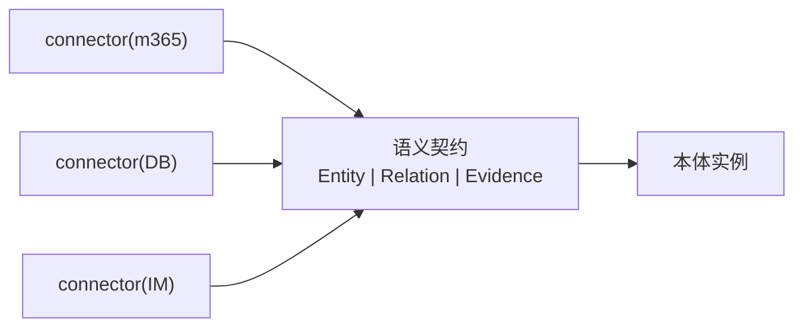
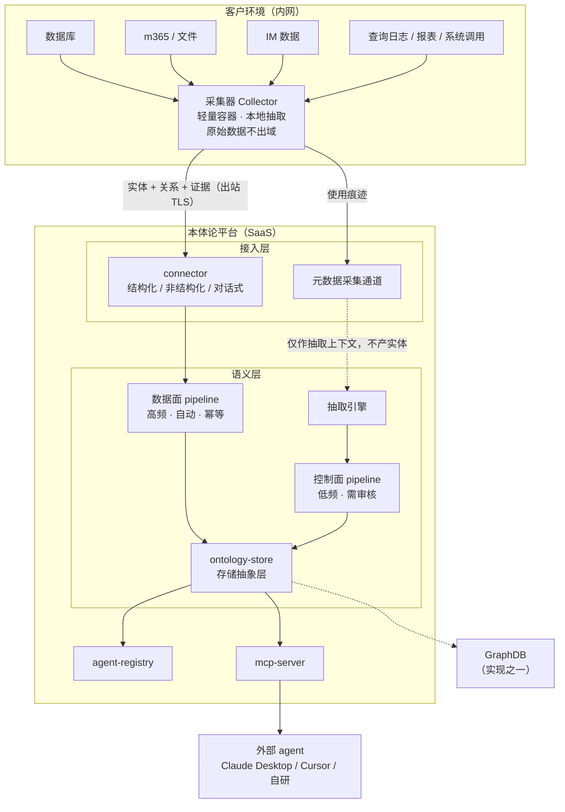
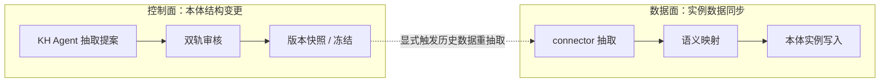
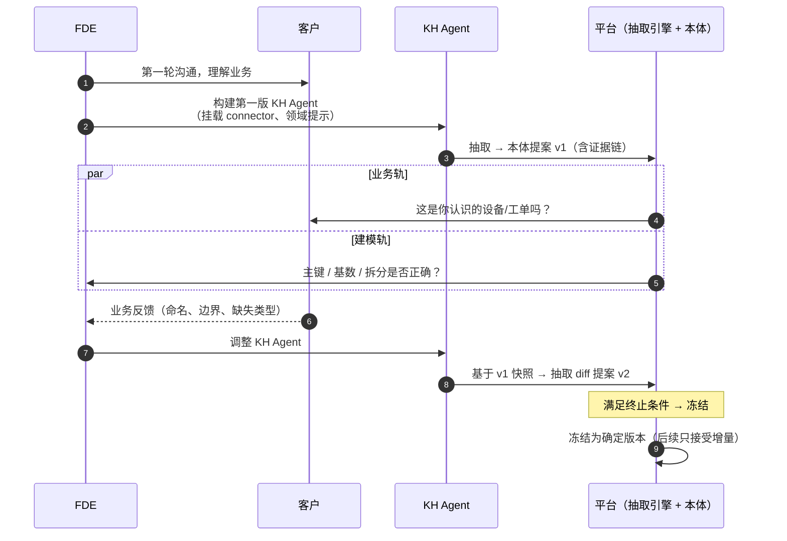
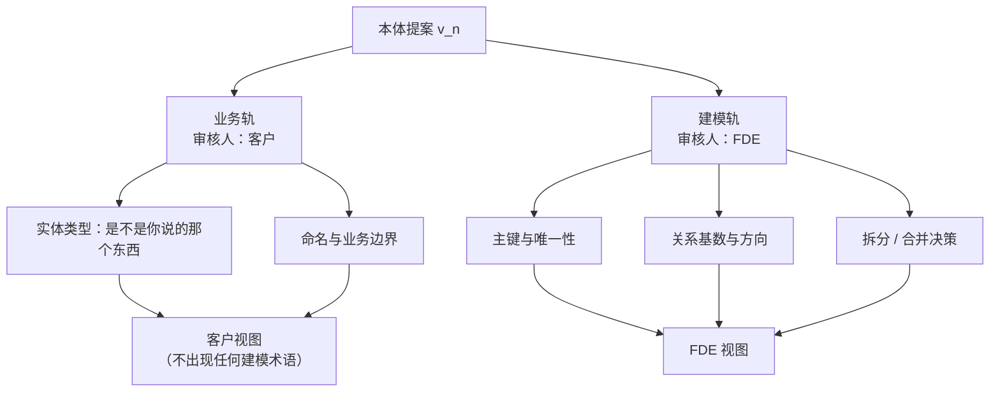
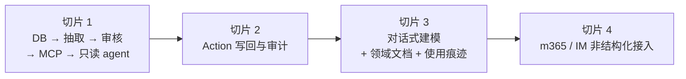

# FDE 本体论平台 · 设计文档（草案）

| 项       | 值                                    |
| -------- | ------------------------------------- |
| 日期     | 2026-09-24                            |
| 状态     | 草案，待评审                          |
| 覆盖范围 | 平台架构、KH Agent 迭代闭环、MVP 切片 |
| 原始输入 | `FDE-本体论.jpg`（架构草图）          |

---

## 1. 背景与定位

### 1.1 要解决的问题

FDE 在客户现场做 AI 落地，普遍卡在同一处：**客户的数据散、口径乱，业务语义只存在于人的脑子里。**

LLM 直连数据库（text-to-SQL）会编造结果，因为没有任何东西约束它"这个世界由哪些东西构成、它们之间是什么关系、能做哪些操作"。本体的作用就是提供这个约束 —— 把 LLM 的语义空间从"任意 SQL"收窄到"本体允许的查询与动作"。幻觉因此从**不可测**变成**可测**：查询要么命中本体，要么明确失败。

### 1.2 定位

三条定位决定了后文所有取舍，有分歧时回看这里：

1. **使用者是 FDE，不是客户的业务人员。** 客户最终看到的是交付出去的 agent 应用，不是平台本身。平台不需要为"客户自助"做设计。
2. **交付以项目为单位。** 平台抽象的是**能力**，不是某个行业的**本体**。一次交付 = 一个项目 = 一套针对该客户抽取出来的本体。
3. **SaaS 优先，私有化部署并存。** 先做 SaaS，架构上为私有化预留同一套组件。

### 1.3 明确不是

- **不是 Palantir Ontology 的平替** —— 不追求多租户 PBAC、connector 生态、Workshop 级低代码应用框架
- **不是知识图谱产品** —— GraphDB 只是本体存储的一种实现，不是架构基石
- **不是数据中台 / ESB** —— 只做语义统一，不做跨系统的逻辑编排
- **不是数据治理平台** —— 不做血缘、质量规则、元数据目录那套

---

## 2. 核心设计主张

以下五条是全部设计决策的依据。

### 2.1 本体是运营层，不是分析层

Palantir Ontology 常被误读成"知识图谱"。它真正的支柱是四件东西：**Object Type（类型化实体）、Link Type（显式关系）、Action Type（唯一写路径）、Function（可执行逻辑）**。关键主张是：本体不只描述世界，它**承载操作并写回世界**。

因此本平台必须保留**写路径**。一个只能读的本体，对客户而言看完演示就没有第二次打开的理由。

> 但写路径不是 MVP 第一切片的内容（见 §8），架构上必须预留。

### 2.2 Agent 是提议者，不是决定者

本体的全部价值是**成为可信的语义真相源**，而 LLM 的输出具有随机性。**如果 agent 能直接修改生产本体，这个平台就自我否定了。**

所以 KH Agent 产出的是**提案（Proposal）**，带证据链，必须经人审核才能落库生效。

### 2.3 抽取结构，人定义语义

这是本平台与 Palantir 的分野，也是核心产品主张：**实体类型不由用户定义，而由 LLM 从数据中抽取。**

这个方向成立，因为**人对"识别"永远比对"凭空定义"可靠**。让客户白纸黑字写出他的对象类型，他写不出来；但给他一份候选，他一眼能说"这个不对，我们管它叫 XX"。

但必须承认抽取的能力边界：

> **数据能告诉你"有什么"，不能告诉你"这算什么"。**

例：`t_dev`、`t_device_info`、`dev_backup` 三张表，字段重叠但不完全相同。若它们是设备生命周期的三个阶段，应建 **3 个类型 + Link**；若只是历史遗留的冗余拆分，应**合并成 1 个类型**。

**这两种判断所依据的数据长得一模一样。** 决定它的是业务语义，不是数据形态。所以：

- **抽取把发现成本从"几周"压到"几分钟"，但不承担决策责任。**
- 类比：LLM 像考古学家，能从地层里挖出骨头并拼出骨架 —— 这是抽取。但"这是什么物种、要不要进展厅、叫什么名"需要馆长签字。**骨架是抽出来的，物种是定义的。**

另需区分两个不同层次的"抽取"，**不可打包成一个概念**：

- **类型抽取**（§6 讨论对象）：发现"这里有一类东西叫设备"
- **实例抽取 + 实体对齐**（本节不讨论）：认出"SN-001 这台设备"，并把散落在 DB、文档、IM 里的同一个东西认成同一个实体

实例对齐是另一个工程量级，且是公认的无底洞。**暂不立项。**

### 2.4 抽象在语义侧收口，不在接入侧

平台上"外部系统皆有抽象"是正确的哲学，但**抽象的位置很关键**。

三类数据源的读取语义本质不同：

- 数据库：schema 内省、增量拉取、CDC
- 文档协作（m365）：分页拉取、解析 Office 格式、抽取正文与结构
- 即时通讯（IM）：拉取消息、按时序/会话聚合、区分群聊单聊

若强行统一成一个 `fetch(): RawRecord[]`，只能把它们各自压扁成扁平记录 —— **文档的段落层级、消息的对话时序会在这一步丢失**，而这些恰恰是 LLM 抽取实体关系时最需要的上下文。

因此：**每个 connector 自由地用最适合自己的方式读，差异由下游的语义映射层消化。统一的是输出（实体 + 关系 + 证据），不是输入。**



### 2.5 复用是后验的归纳，不是先验的设计

FDE 交付以项目为单位，**本体本身大概率不可跨项目复用** —— 每个客户的业务语义都是特有的。

**行业抽象必须是后验的**：做过 5 个同行业项目之后回头看，才知道哪些是行业共性、哪些是那家客户的怪癖。只有一个样本时做抽象，抽出来的必然是那个客户的怪癖。

因此架构上：**不阻碍未来的抽象，但不为它做设计。**

唯一的例外是 §7.4 的"项目快照导出"—— 成本几乎为零，但为将来的归纳留下原料。

---

## 3. 术语表

| 术语                   | 含义                                                                       |
| ---------------------- | -------------------------------------------------------------------------- |
| **Entity Type**        | 实体类型（对象类型）。本体的 schema 层，如"设备""工单"                     |
| **Entity Instance**    | 实体实例。类型的具体个体，如"编号 SN-001 的设备"                           |
| **抽取（Extraction）** | LLM 从输入数据中推导候选实体类型与关系的过程。产物是**提案**，不是既成事实 |
| **提案（Proposal）**   | KH Agent 产出的本体变更建议，含证据链，待审核                              |
| **快照（Snapshot）**   | 某一轮抽取产出的、确定的本体版本                                           |
| **冻结（Freeze）**     | 已审核通过的本体版本。后续抽取只能在其上追加 diff，不可覆盖                |
| **双轨审核**           | 业务轨（客户审语义正确性）+ 建模轨（FDE 审建模质量）                       |
| **数据面 / 控制面**    | 数据面 = 实例数据的同步；控制面 = 本体结构的变更。见 §4.3                  |

---

## 4. 系统架构

### 4.1 总体分层



**关键点**：

- `ontology-store` 是**存储抽象**，GraphDB 只是其实现之一。存储可替换，上层无感
- 采集器与平台之间**只传实体+关系+证据**，原始数据留在客户域内
- 元数据通道（使用痕迹）**不进本体**，只喂抽取引擎（见 §5.3）
- `agent-registry` **只服务建侧**，图上没有出边是刻意的。它是 **KH Agent 的抽象层**（注册 / 版本 / 迭代记录），承载 FDE 反复调整 KH Agent 的那套闭环（见 §6）。**外部 agent 不经过它** —— 外部 agent 只经 `mcp-server` 进来消费本体。两者名字里都有 agent，但一个是造本体的、一个是读本体的

### 4.2 采集层：SaaS 与客户内网的边界

SaaS 在公网，客户数据在内网。**connector 无法直连客户数据源**，这是 SaaS 形态的硬约束。

因此需要**客户侧采集器**：一个轻量容器（目标：一条命令部署），装在客户内网，主动出站连接 SaaS。

职责划分：

- **采集器（客户侧）**：连接数据源、执行连通性测试、驱动抽取、本地标准化为"实体 + 关系 + 证据"
- **平台（SaaS 侧）**：接收标准化结果、语义映射、抽取、本体管理、审核、MCP 暴露

**核心约束：原始数据不出客户环境。** 这条是合规刚需（尤其 IM 内容），也是对客户沟通时的核心话术。

**收益**：私有化部署 = 把 SaaS 整体搬进客户环境，采集器**在两种形态下都复用**（私有化时退化成本地直连，或保留作为隔离层）。一个组件吃掉两种形态，FDE 不必维护两套交付流程。

### 4.3 数据面与控制面

进入 pipeline 的东西性质不同，**必须分车道**：



|            | 数据面            | 控制面         |
| ---------- | ----------------- | -------------- |
| 频率       | 高频              | 低频           |
| 触发       | 自动（定时/增量） | 人工审核通过   |
| 幂等       | 是，可重放        | 否，有语义后果 |
| 是否需要人 | 否                | **是**         |

**为什么不合并**：混在一条流水线里会出现两个后果 —— 无法区分"哪些变化需要人看"；本体结构一变是否触发历史数据重算变得不可控。

本体变更后的历史数据重抽取，必须在图上**显式表达**（虚线），作为可观测、可审批的动作，不能靠流水线自然流动。

### 4.4 存储抽象

```text
ontology-store（抽象接口）
    ├── GraphDB 实现（Neo4j 等）
    ├── RDBMS 实现（PostgreSQL：JSONB + 邻接表 + pgvector）
    └── 内存实现（测试用）
```

**选型说明**：企业本体的实际查询深度通常 ≤ 3 跳，PostgreSQL 完全够用；GraphDB 的价值在 10 跳以上的深链查询和超大规模图。**切片 1 建议直接用 PostgreSQL 实现**，理由是客户环境里大概率本来就有 PG，少一个中间件就少一个交付障碍 —— 对 FDE 而言，部署阻力是最大的敌人。

### 4.5 接入面（MCP）

`mcp-server` 把本体暴露为标准 MCP 工具，任何 MCP 客户端（Claude Desktop、Cursor、自研 agent）无需 SDK 即可消费。

**这是架构中性价比最高的一环**：不写 agent runtime、不写 SDK、不绑定任何模型厂商，接入面与后端实现完全解耦。

---

## 5. Connector 能力模型

### 5.1 用能力标签，不做继承树

connector 分类为**结构化 / 非结构化 / 对话式**。这层分类是必要的，但**实现上不建继承树，改用能力标签（capability tag）**。

理由：继承树在运行时会僵化。例如 m365 既有文档（非结构化）又有日历（结构化），在单继承下无法归类。改为每个 connector 声明自己支持的**能力集合**，KH Agent 按能力勾选：

| 能力标签            | 含义       | 典型来源            |
| ------------------- | ---------- | ------------------- |
| `read_schema`       | 读表结构   | 数据库              |
| `read_rows`         | 读行样本   | 数据库              |
| `read_text`         | 读文本内容 | m365 / 文件         |
| `read_conversation` | 读对话时序 | IM                  |
| `read_metadata`     | 读使用痕迹 | 查询日志 / 报表定义 |

好处：新增 connector 不需要修改类型体系；KH Agent 的选装逻辑简化为"勾选能力"。

### 5.2 机制约束：一次抽取会话内固定 connector 集合

**connector 集合必须在一次抽取会话开始时固定。** 中途挂载新 connector 等于换了输入，此前的收敛判定作废，须显式开启新一轮迭代。

不加这条约束，"收敛"这个判据就不可信。

### 5.3 元数据通道：使用痕迹不是 connector

**"数据被怎么用"比"数据长什么样"更能揭示语义。** 例：`t_dev` 与 `t_device_info` 在 87% 的查询里都被 join 在一起 → 很可能同一个实体；若从不 join → 很可能是两种东西。这个信号比字段名相似度可靠得多，且免费存在于客户环境中。

但使用痕迹**不适合塞进 connector 分类**，因为两者职责不同：

- **connector 抽的是本体要描述的对象** —— 设备、工单、合同，**进本体**
- **使用痕迹描述的是这些对象在业务里怎么被用** —— **不进本体**

因此它是与 connector **平行的第二条输入通道**，输出只作为抽取引擎的上下文。

**架构上必须为它留位置**，不能让"所有输入都是 connector"这个假设把路堵死。切片 1 先不做（见 §8）。

---

## 6. KH Agent 迭代闭环

KH Agent 的定位：**本体抽取辅助**。它不定义本体，负责产出候选。

### 6.1 闭环流程



**关键设计：FDE 调的是 KH Agent，不是本体。**

若 FDE 直接改本体，会撞上两堵墙：下一轮抽取会重新生成，改动被覆盖；且本体是客户特有的，跨项目复用不了。

而 KH Agent 里装的是"**怎么从一堆表里认出设备/工单/合同**"这套方法 —— **方法是跨项目可复用的**。第二个同行业客户可以直接拿第一个客户调好的 KH Agent 当起点（注意：这是能力层复用，不是本体复用，见 §2.5）。

### 6.2 双轨审核

客户没有能力判断建模质量（主键、基数、规范化），让他审这些他只会随便点"通过"。因此拆成两轨：



**同一版本体，两个视图。** 客户看到"这些是我认识的设备吗"，FDE 看到"这个本体建对了吗"。客户视图中不得出现主键、外键、基数等建模术语。

### 6.3 版本化：快照 / diff / 冻结

这是闭环能**收敛**的保证。

若每轮都**重新生成**，LLM 的随机性会让结果漂移：客户看到 3 个类型说"太多"，下一轮看到 1 个说"太少"，来回振荡不收敛。

正确机制：

1. **快照**：每轮抽取的结果落库，带版本号
2. **diff**：下一轮是"**基于上一版快照 + 新反馈，产出 diff 提案**"，不是重新生成。客户对比的是增量，不是两个全新产物
3. **冻结**：审核通过的部分冻结，后续抽取只在其上追加，不可覆盖

这样"迭代"才真正是**累积**，而不是反复洗牌。

同时，每个新抽取的类型/属性**必须携带证据**（"从哪几张表的哪几个字段推断而来"），否则人无法有效审核，双轨审核会退化成盲审。

### 6.4 终止条件

没有终止条件，这个循环就是无底洞 —— FDE 会永远觉得"再调一版会更好"。三个信号，**任一满足即可收**：

1. **覆盖率**：数据源中有多少字段/表被映射进本体，未映射率降到阈值以下
2. **稳定性**：连续两轮抽取的 diff 小于阈值（已收敛）
3. **验收**：客户签字

> 数值阈值待切片 1 实测后校准，不在本草案中拍定。

**认知对齐**：不存在"正确的本体"，只有"够用的本体"。本体是工具不是真理 —— 目标是"让 agent 能可靠回答客户的问题"，不是"完美刻画客户的业务"。

---

## 7. 项目与部署形态

### 7.1 两种形态

- **SaaS（优先）**：平台部署在公网，客户侧只装采集器
- **私有化部署**：整套平台搬进客户环境，采集器复用于本地直连或保留作隔离层

两者共用同一套组件，**不维护两套交付流程**（见 §4.2）。

### 7.2 项目是一等公民

SaaS 上会并行运行多个客户项目，**项目间必须强隔离**。

准确表述：**项目之间强隔离（安全刚需），项目内部不做细粒度权限（使用者是 FDE，省掉）。**

因此需要 `Project` 作为架构中的一级概念，所有本体、KH Agent 配置、数据连接、迭代记录均归属某个项目。

### 7.3 平台能力 vs 项目产物

这条线必须画清楚：

|      | 平台能力（跨项目，越强越好）                                                         | 项目产物（项目内，互不相干）                    |
| ---- | ------------------------------------------------------------------------------------ | ----------------------------------------------- |
| 内容 | connector 库、抽取引擎、双轨审核界面、mcp-server、存储抽象、pipeline、agent-registry | 该客户的本体、KH Agent 配置、数据连接、迭代记录 |
| 归属 | 平台                                                                                 | 单个项目                                        |

**"复用"的位置由此自动清晰**：复用在能力层（connector 支持的数据源越多、抽取引擎越准，每个新项目越省力），不在产物层。

### 7.4 项目快照导出

**唯一为未来预留的东西**：一个项目交付完成后，其本体（含版本历史与证据链）能**一键导出为结构化文件**。

成本几乎为零，但将来做行业归纳时，手上会有 N 份真实样本。**不做更多**（见 §9）。

---

## 8. MVP 范围与切片

### 8.1 切片顺序

按"多快能证明价值"排序，而非按功能完整性。



**切片 1：只读闭环（目标：一周内可演示，且真能用）**

- 仅支持一种数据源（PostgreSQL / MySQL）
- LLM 内省表结构 + 真实行样本 → 生成候选本体 → 双轨审核 → 落库
- `mcp-server` 暴露查询工具
- Claude Desktop 接上即可提问

**为什么把非结构化（切片 4）放最后**：**实体对齐（entity resolution）是无底洞** —— 把文档里的"张三"对到数据库里的员工记录，这件事能让人陷进去数月。切片 1 已能证明价值，不必陪它一起沉。

**为什么 Action（切片 2）先于非结构化（切片 4）**：Action 是"运营层"的分水岭（客户续约的理由），且实现成本远低于实体对齐。

### 8.2 切片 1 的验收标准

- 输入：一个**真实客户**的 PG/MySQL 数据源（非构造数据）
- FDE 在**一个工作日内**产出第一版本体提案
- 每个类型/属性提案**携带证据**
- 客户能在**业务轨**独立完成审核，无需 FDE 解释建模概念
- 审核通过后，Claude Desktop 经 MCP 连接，能回答**至少 5 个客户级业务问题**
- 覆盖率达到阈值（数值待校准）

---

## 9. 明确不做

以下均已在讨论中确认排除，**不要因为"顺手"而加回来**：

| 不做                                              | 理由                                |
| ------------------------------------------------- | ----------------------------------- |
| 本体模板系统 / 行业包 / 类型继承 / 跨项目本体引用 | 复用必须后验（§2.5）                |
| 图数据库强依赖                                    | 存储是抽象层，PG 足够（§4.4）       |
| 项目内的行级权限                                  | 使用者是 FDE（§7.2）                |
| 流式/实时处理                                     | 交付场景先做批                      |
| 跨系统逻辑编排                                    | 会退化成 ESB，平台只做语义统一      |
| 面向客户业务人员的自助 UI                         | 客户看的是交付的 agent 应用（§1.2） |
| 实例层的实体对齐                                  | 无底洞，另行立项（§2.3）            |
| Git 式本体分支/合并                               | 双轨审核 + 快照 diff 已够用（§6.3） |
| 数据血缘 / 质量规则 / 元数据目录                  | 是数据治理平台的范围                |

---

## 10. 待定项与风险

### 10.1 待定

- 收敛阈值与覆盖率阈值的具体数值（切片 1 实测校准）
- 抽取引擎的模型选型与 token 成本估算
- 使用痕迹采集的具体形式（切片 3 细化）
- m365 connector 的认证复杂度（切片 4 前评估）
- 采集器在客户内网的部署方式（容器 / 二进制）
- SaaS 数据合规边界：哪些数据绝对不出客户环境（已定原则，待形成清单）
- 是否 `git init` 本仓库

### 10.2 风险

| 风险               | 说明                           | 缓解                                   |
| ------------------ | ------------------------------ | -------------------------------------- |
| **收敛性**         | LLM 随机性导致迭代振荡         | 快照 + diff + 冻结（§6.3）             |
| **审核疲劳**       | 客户看多轮后随便点"通过"       | 双轨审核降认知负担；限制轮次           |
| **采集器落地阻力** | 客户 IT 部门审批慢             | 一条命令部署；最小权限；明确数据不出域 |
| **抽取质量**       | 缺领域文档时易猜错             | 切片 3 补领域文档与使用痕迹            |
| **过度抽取**       | LLM 产出几十个细碎类型         | 给约束：业务域边界 + 粗粒度优先        |
| **演示导向偏移**   | 为演示效果做假数据，掩盖真问题 | 验收标准强制要求真实客户数据源（§8.2） |

---

## 附：与原始架构草图的差异

| 草图                     | 本设计                           | 原因                                |
| ------------------------ | -------------------------------- | ----------------------------------- |
| connector 直连平台       | 增加客户侧采集器                 | SaaS 在公网，连不上客户内网（§4.2） |
| GraphDB 作为平台外挂存储 | 降级为 ontology-store 的一种实现 | 存储是抽象层，PG 优先（§4.4）       |
| pipeline 单一            | 拆数据面 / 控制面                | 性质不同，混用不可控（§4.3）        |
| 无写路径                 | 预留在切片 2                     | 否则退化为只读字典（§2.1）          |
| 无审核环节               | 增加双轨审核 + 提案制            | Agent 不能直写本体（§2.2 / §6.2）   |
| 无项目概念               | 项目为一等公民                   | SaaS 形态下的隔离刚需（§7.2）       |
| 抽象在接入侧             | 抽象移到语义侧                   | 输入模态的差异是本质的（§2.4）      |
