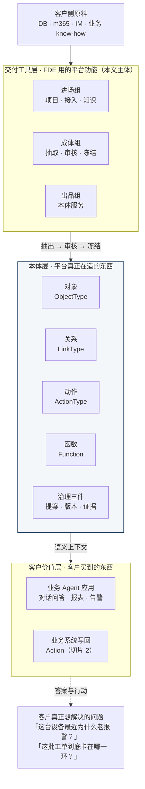
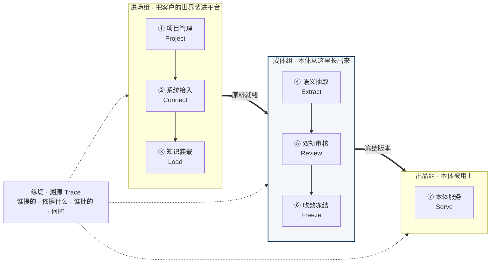
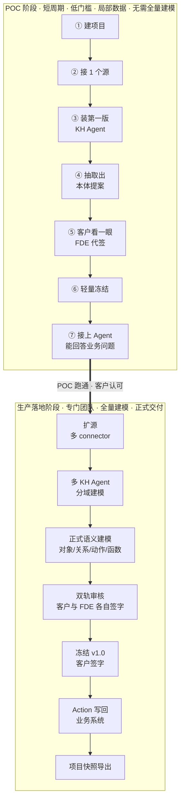
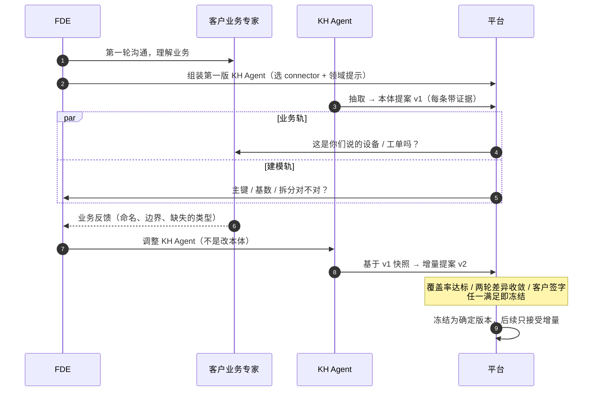
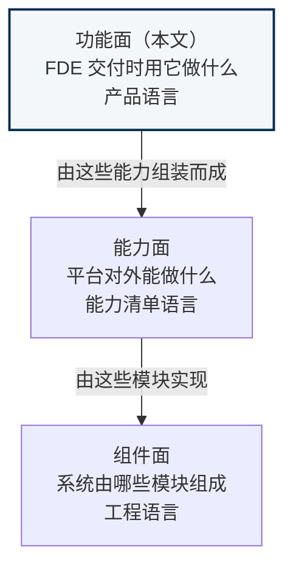

# 本体平台 · 功能面架构

> **本文视角**：站在「FDE 完成一次客户交付」的角度，看这套平台由哪些**功能**构成。
> 读者是老板、产品、FDE。全文不含任何技术选型词。
>
> **与上下两层的关系**：
>
> - **功能面（本文）** —— 回答「FDE 交付时，用这套平台做什么事」。以**交付旅程**为轴，是**产品语言**。
> - **能力面**（`2026-09-24-capability-plane.md`）—— 回答「平台对外能做什么」。以**平台自身**为轴，是**能力清单语言**。
> - **组件面**（`2026-09-24-fde-ontology-platform-design.md` §4.1）—— 回答「系统由哪些模块组成」。以**实现**为轴，是**工程语言**。
>
> **本文的由来**：2026-09-24 对齐会议 —— 「过于偏向底层技术实现，与本体核心逻辑关联度不足，需进一步向上抽象调整」。
> 能力面把主视觉从**模块**换成了**能力**；本文再上一层，把主视觉从**能力**换成**交付**。

---

## 1. 一句话

> 这个平台只做一件事：**把客户系统里的数据与 know-how，变成 Agent 能理解的业务语义。**

这句话里有两个词是全部价值的来源：

- **速度** —— FDE 第一次进客户现场，多久能拿出第一版可讨论的本体？
- **可信度** —— 每一条语义，有没有证据、有没有人签字？

功能面上的七个功能域，全部是围绕这两个词展开的。任何一个功能域，如果既不加快速度、也不提高可信度，就不该出现在这张图上。

---

## 2. 为什么还要再上一层

能力面已经讲了「平台能做什么」，为什么不够？

因为它回答的是**平台自己**的问题，没回答**交付这件事**的问题：

| 问题 | 谁在问 | 哪一层回答 |
| --- | --- | --- |
| 系统由哪些模块组成 | 工程师 | 组件面 |
| 平台对外能做什么 | 老板、客户 | 能力面 |
| **为什么需要这个平台** | 老板、客户、销售 | **功能面** |
| **FDE 拿它怎么完成一次交付** | FDE、交付负责人 | **功能面** |
| **客户凭什么签字、凭什么续约** | 客户 | **功能面** |

**关键的差别是视角的方向**：

- 能力面是**共时**的 —— 站在平台外面往里看，此刻平台有哪些牌。
- 功能面是**历时**的 —— 站在交付里面往外看，一个项目从头到尾走一遍，每一步谁在干活、产出什么、什么时候停。

能力面像一张**名片**（我们有什么），功能面像一张**作战地图**（这一仗怎么打）。

---

## 3. 总图：本体在中间

这张图的画法是**从客户价值往下倒推**，而不是从模块往上堆 —— 倒推才能保证每一层都有存在的理由。

**读这张图，三句话**：

1. **客户买的不是平台，是一个能回答他问题的 Agent。** 平台本身不产生价值，它只是这条价值链的中段。
2. **Agent 需要的是语义，不是数据表。** 把表给 Agent，它给出的是查询幻觉；把本体给 Agent，它才能回答业务问题。**中间这一层才是平台存在的理由。**
3. **本体不是人手画的，是 FDE 用平台从客户系统里抽出来的。** 底部那一层（进场组 / 成体组 / 出品组）就是本文要讲的全部内容。

### 3.1 本体核心逻辑 —— 为什么「本体」必须在正中间

会议指出上一版架构「与本体核心逻辑关联度不足」。这里把它讲透。本体之所以不是「高级版的数据字典」，靠的是三条：

1. **对象是从数据里认出来的，不是搬过来的。**
   把表搬进平台，它还是表。只有「这几张表说的其实是同一种设备」这个判断被做出来，意义才出现。**抽取不是一个搬运动作，是一个认知动作。**
2. **企业的真相在关系里，不在单表里。**
   设备、工单、合同各自躺在各自的系统里，业务价值全在它们之间的连线上 —— 「这台设备的故障史」「这批工单关联的合同」。**关系必须是一等公民**，能单独带基数、带语义、带证据。
3. **本体最终要驱动行动，不能只是被读。**
   一个只能回答问题的本体是知识图谱；一个能驱动业务系统发生真实变更（派单、审批、冻结）的本体，才是运营层。**这是客户续约的理由。**

功能面上的七个功能域，**④⑤⑥ 直接作用于本体**，其余四个全部是在为这三个供货或消化产物。**本体始终在画面中央，这是本层的一条硬约束。**

---

## 4. 七个功能域

分三组：**进场**（把客户的世界装进平台）· **成体**（本体从这里长出来）· **出品**（本体被用上）。

### 4.1 进场组 —— 把客户的世界装进平台

#### ① 项目管理 Project

- **谁用**：FDE（主）；客户 IT（被邀请）
- **解决什么**：SaaS 上同时跑着好几个客户的项目，谁也别看见谁
- **输入**：客户信息、部署形态选择（SaaS / 私有化）
- **产出**：一个**项目空间** —— 该客户的本体、KH Agent 配置、数据连接、全部迭代记录都归属它
- **取舍**：项目**之间**强隔离（安全刚需）；项目**内部**不做细粒度权限（使用者就是 FDE 自己，省掉）

#### ② 系统接入 Connect

- **谁用**：FDE（主操作）；客户 IT（提供凭据 / 放行）
- **解决什么**：让平台「看得见」客户的数据
- **输入**：数据源凭据、connector 选装清单
- **产出**：一份**数据地图** —— 有哪些表 / 字段 / 文档 / 会话，样本长什么样
- **取舍**：
  - connector 按**能力标签**选装（读结构 / 读行 / 读文本 / 读对话 / 读使用痕迹），**不建继承树** —— 因为 m365 这种东西既有文档又有日历，单继承归不了类
  - **原始数据不出客户环境**。这条是合规刚需（尤其 IM 内容），也是对客户沟通时的核心话术

#### ③ 知识装载 Load

- **谁用**：FDE（主）；客户业务专家（供给 know-how）
- **解决什么**：**数据里没有的东西** —— 业务规则、行业暗语、约定俗成、历史包袱
- **输入**：客户访谈、领域文档、术语表、历史工单
- **产出**：**一个装好的 KH Agent**（connector 选装 + 领域提示 + 约束）
- **取舍**：**KH Agent 是被迭代的对象，不是一次性的配置。** 这是整套方法论的核心 —— FDE 调的是 Agent，不是本体；因为 Agent 里装的是「怎么从一堆表里认出设备/工单」这套方法，**方法是跨项目可复用的**，而本体不是。

### 4.2 成体组 —— 本体从这里长出来（核心）

这三个功能域是**唯一直接作用于本体**的部分。前面三个功能域都是在给这里备料，后面一个是在消化这里的产物。

#### ④ 语义抽取 Extract

- **谁用**：FDE（触发）；KH Agent（执行）
- **解决什么**：从表和文档里**认出**业务对象 —— 而不是等客户坐下来定义
- **输入**：上一版本体快照 + 人工反馈 + connector 拉到的数据
- **产出**：**本体提案** —— 候选的对象与关系清单，每条带证据
- **取舍**（三条，都是硬约束）：
  1. **产出的是提案，不是直接改本体。** Agent 是提议者，不是决定者。
  2. **基于上一版做增量，不重新生成。** 每轮都重生成，模型的随机性会让结果来回漂移，永远收敛不了。
  3. **一次抽取会话内，connector 集合固定。** 中途换输入，此前的收敛判定作废。

#### ⑤ 双轨审核 Review

- **谁用**：客户业务专家（业务轨）+ FDE（建模轨）
- **解决什么**：**客户看不懂主键和基数，FDE 看不出业务对错 —— 一轨审不了。**
  让客户审建模质量，他只会随便点「通过」；让 FDE 替客户判断业务含义，等于没审。
- **输入**：本体提案
- **产出**：逐条结论（通过 / 打回 / 需修改）
- **取舍**：同一版本体，**两个视图**。
  - 客户看的是：「这些是你们说的设备吗？名字对吗？」
  - FDE 看的是：「这个主键对吗？这对关系的基数对吗？」
  - **客户视图里不得出现任何建模术语。**

#### ⑥ 收敛冻结 Freeze

- **谁用**：FDE（判断）；客户（签字）
- **解决什么**：**不说停，这个循环就是无底洞。** FDE 会永远觉得「再调一版会更好」。
- **输入**：多轮迭代记录 + 覆盖率与稳定性指标
- **产出**：**冻结的本体版本** + 客户签字
- **取舍**：三个终止信号，**任一满足即可收**：
  1. **覆盖率** —— 数据源里有多少被打进本体，未映射率降到阈值以下
  2. **稳定性** —— 连续两轮的版本差异小于阈值
  3. **验收** —— 客户签字
  数值阈值待 POC 实测后校准。

> **认知对齐（重要，对客户也要这么讲）**：不存在「正确的本体」，只有「够用的本体」。
> 目标是**让 Agent 能可靠回答客户的业务问题**，不是完美刻画客户的业务。这条认知不摆正，项目会在「再改改」里无限期拖延。

### 4.3 出品组 —— 本体被用上

#### ⑦ 本体服务 Serve

- **谁用**：外部 Agent（Claude Desktop / Cursor / 自研）、业务系统
- **解决什么**：**本体被用上，交付才算完成。** 前面六个功能域都是在为这里供货。
- **输入**：冻结的本体版本
- **产出**：Agent 可用的**语义上下文** —— 客户真正买单的东西；（切片 2）业务系统的**真实变更**
- **取舍**：
  - **只读冻结版本，不读未审提案** —— 未审的东西不能给 Agent 用
  - 不写 agent runtime、不写 SDK、不绑任何模型厂商。接入面与后端实现完全解耦

### 4.4 纵切与后验

#### 纵切 · 溯源 Trace

溯源不是第八个功能域，**它横跨前面全部**：不是一步操作，而是每个操作都必须写下的属性。

每个对象 / 关系 / 动作都挂四个字段：**谁提的 · 依据哪条数据 · 谁批的 · 何时**。

没有这条纵切，双轨审核会退化成盲审，客户签字也会签得心里没底。

#### 后验 · 沉淀 Compound（不在交付周期内）

一个项目交付完成后，其本体（含版本历史与证据链）**一键导出为结构化文件**，成本几乎为零。

但要说清楚：**这是做了 N 个项目之后回过头来做的事，不是交付流程的一环。**

- 可以复用的是**建模逻辑**（KH Agent 里那套方法、connector 库）
- 不好复用的是**模型本身**（每个客户的本体是客户特有的）
- **行业的建模抽象，只能在一个行业做了多个项目之后再归纳** —— 这是后验的，现在做就是拍脑袋

功能面上给它留一个出口即可，不做更多。

---

## 5. 一个 FDE 项目的完整旅程

把七个功能域按时间排开，就是 FDE 实际干活的样子。

### 5.1 迭代闭环长什么样

POC 阶段里，③④⑤ 会循环好几轮。这个环跑几轮、什么时候停，是项目成败的关键：

**注意环里被调整的是 KH Agent，不是本体。** 原因在 ③ 的取舍里：调 Agent 是可复用的方法，改本体是一次性的产物。

---

## 6. POC 与生产：同一套功能，两种开启深度

会议确定：POC 阶段轻量快速跑通、**不得设置过高的人员能力要求**、**无需全量语义建模**；生产落地阶段再由专门团队正式建模。

落到功能面上，就是**同一套功能域的两种开启深度** —— 不是两套系统，也不维护两套交付流程。

| 维度 | POC 阶段 | 生产落地阶段 |
| --- | --- | --- |
| 目标 | 证明「能跑通、真能用」 | 正式交付并持续运营 |
| 人员 | **1 个 FDE 即可**，无建模专家要求 | 专门团队（含语义建模） |
| 数据 | 局部必要验证数据 | 全量 |
| ① 项目管理 | 单项目 | 多项目并行 |
| ② 系统接入 | 单数据源，一类 connector | 多源，多类 connector |
| ③ 知识装载 | 单 KH Agent | 多 KH Agent，分域 |
| ④ 语义抽取 | 对象 + 关系 | 对象 + 关系 + **动作 + 函数** |
| ⑤ 双轨审核 | **单轨即可（FDE 代签）** | 双轨，客户与 FDE 各自签字 |
| ⑥ 收敛冻结 | 轻量：覆盖率达标 + 客户认可 | 双阈值 + 客户正式签字 |
| ⑦ 本体服务 | 只读 MCP | 只读 + **Action 写回 + 权限 + 审计** |
| 溯源 | 最小形态：点开类型能看见来源 | 完整证据链，出口对齐标准格式 |
| 交付物 | 一页纸本体文档 + 能问答的 Agent | 正式本体 + 可写回的业务闭环 |

**POC 的门槛只有三条**：

1. FDE 能在**一个数据源**上跑通一次抽取，产出一份本体提案
2. 客户能在**一页纸**上看懂「有哪些对象、什么关系、每条从哪来」，并认可
3. 接上 Agent，能回答**至少 5 个客户级业务问题**

> 「动作」和「完整溯源」在 POC 阶段**不实现，但位置必须留着** —— 否则生产阶段要推翻 POC 重来。

---

## 7. 功能域 × 角色

|  | 客户业务专家 | FDE 工程师 | 客户 IT | 外部 Agent / 业务系统 |
| --- | --- | --- | --- | --- |
| ① 项目管理 | — | **主** | 被邀请 | — |
| ② 系统接入 | — | **主** | 放行 · 凭据 | — |
| ③ 知识装载 | 供给 | **主** | — | — |
| ④ 语义抽取 | — | **主**（触发） | — | — |
| ⑤ 双轨审核 | **主**（业务轨） | **主**（建模轨） | — | — |
| ⑥ 收敛冻结 | **签字** | **主**（判断） | — | — |
| ⑦ 本体服务 | 受益 | 调试 | 授权 | **主**（读 / 调） |
| 溯源（纵切） | 看 | 看 | 看 | — |

**读法**：

- **①②③④ 是 FDE 的单人区** —— 这是 POC 阶段一个人就能跑通的结构保证
- **⑤ 被拆成两个位置** —— 强制客户和 FDE 各签各的，谁也不能替谁签
- **⑥ 的签字权在客户手里** —— 交付完成的判据不在 FDE 自己的感觉里
- **⑦ 的写回钥匙在客户 IT 手里** —— 不在 FDE 手里

---

## 8. 三张图的分工

| 功能面（本文） | 落在能力面的哪里 |
| --- | --- |
| ① 项目管理 | 「建」的前置（项目容器） |
| ② 系统接入 + ③ 知识装载 + ④ 语义抽取 | **建 Build** |
| ⑤ 双轨审核 + ⑥ 收敛冻结 | **审 Review** |
| ⑦ 本体服务（只读部分） | **用 Use** |
| ⑦ 本体服务（写回部分） | **动 Act** |
| 溯源（纵切） | **溯 Trace** |

**两层的真实差别**：能力面把「建」当成**一个**动作；功能面把它拆成**四个**功能域，因为 FDE 干这四件事时用的是四套不同的界面、见的是四批不同的人。

**具体来说**：

- 能力面告诉老板「这个平台能建、能审、能用、能动」
- 功能面告诉老板「FDE 第一周干什么、第几周能让客户签字、签字之后客户能拿到什么」

三张图不冲突，是同一套系统的三种读法，各自面向不同的读者。

---

## 9. 功能面的三条设计主线

如果只记三句话：

1. **本体始终在画面中央。**
   七个功能域里，只有三个（④⑤⑥）真正作用于本体，其余四个都在为它们供货或消化它们的产物。任何偏离这条线的功能需求，都应该被问一句：**它加速了速度，还是提高了可信度？**

2. **速度与可信度是两条主脉，且它们有张力。**
   追速度就会想「让 Agent 全自动跑完」，追可信度就会想「每条都让人审」。功能面的解法是**把它们分到不同的位置**：抽取（④）全自动、审核（⑤）强制人工、冻结（⑥）用指标而不是用感觉来判停。

3. **POC 轻、生产全，但底座是同一套。**
   ⑤ 在 POC 阶段可以单轨代签、⑦ 可以只读 —— 但**位置不能省**。省掉位置，生产阶段就得推翻重来，而推翻重来对一个已经交付过的客户项目是不可接受的。

---

## 10. 本文回应了什么

逐条对应 2026-09-24 会议纪要：

- **「过于偏向底层技术实现」** → 本文全文不出现任何技术选型词，主视觉是**七个业务功能域**和**一条交付旅程**。
- **「与本体核心逻辑关联度不足」** → §3.1 把本体核心逻辑三条讲透，并作为一条硬约束写进 §4：**七个功能域里只有三个直接作用于本体，本体始终在画面中央**。
- **「需进一步向上抽象调整」** → 抽象的终点是**交付**，不是更抽象的技术分层。功能面的主语是「FDE 在做的事」，不是「平台有的东西」。
- **「为什么需要这个平台」**（此前没人回答的问题）→ §3 总图从客户价值倒推：客户买的不是平台，是一个能回答业务问题的 Agent；而 Agent 需要的是语义，不是数据表。
- **「POC 轻量、快速跑通、不得设置过高人员能力要求」** → §6 给出同一套功能的两种开启深度：POC 只需 1 个 FDE、单源、单轨、只读；§7 显示 ①②③④ 是 FDE 单人区，结构上保证了一个人跑得通。
- **「生产落地阶段再由专门团队开展正式语义建模」** → §6 右侧列：动作、函数、完整证据链、Action 写回都是为这一阶段预留的位置，POC 阶段只占位不实现。
- **「迭代终止条件：数据源映射阈值 + 版本间差异收敛阈值，达标后客户签字」** → 落在 ⑥ 收敛冻结，三个信号并列，**客户签字是其中之一**。
- **「复用」的边界** → §4.4 后验沉淀：可复用的是建模逻辑（KH Agent 里的方法），不是模型本身；行业抽象必须等一个行业做了多个项目之后再归纳。

---

*配套自包含 HTML：`2026-09-28-functional-plane.html`（可离线双击打开，含 SVG 版同一张图）。*
*上层：`2026-09-24-capability-plane.md` · 下层：`2026-09-24-fde-ontology-platform-design.md`*
