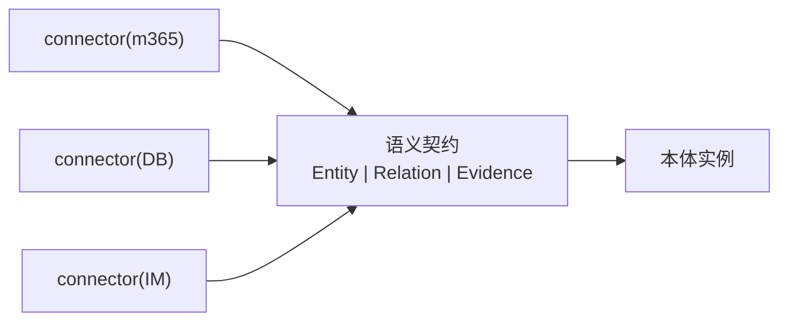
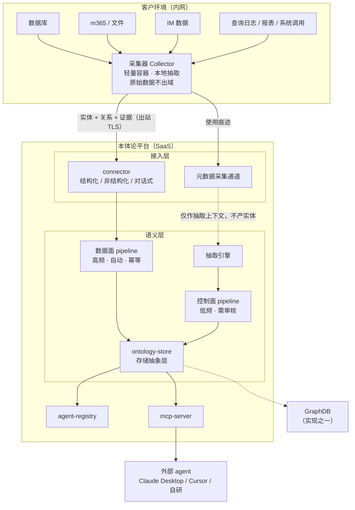
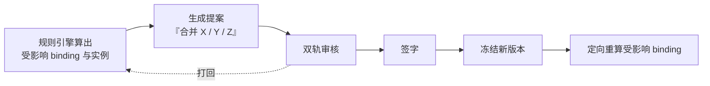
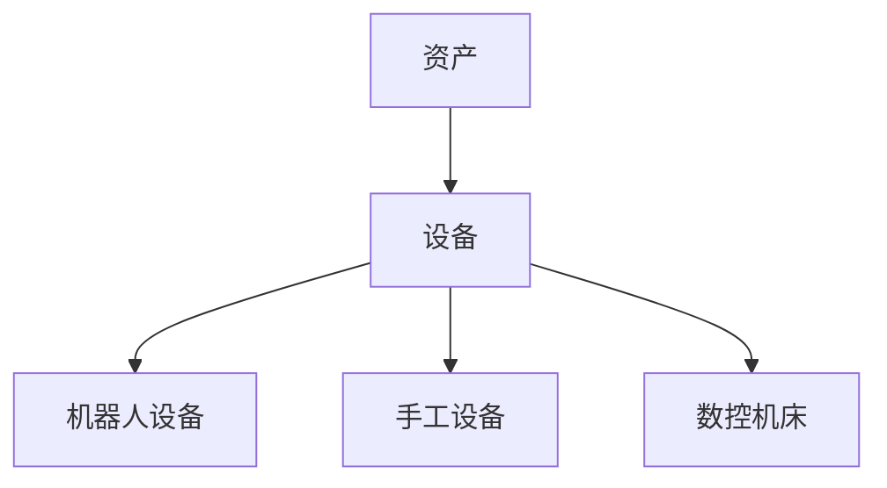
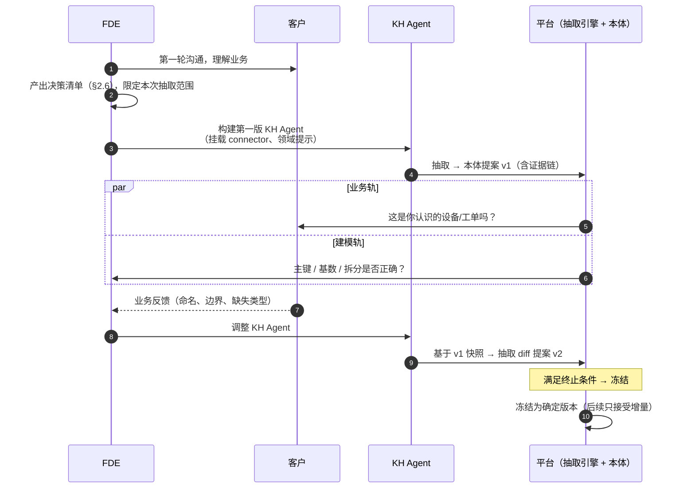
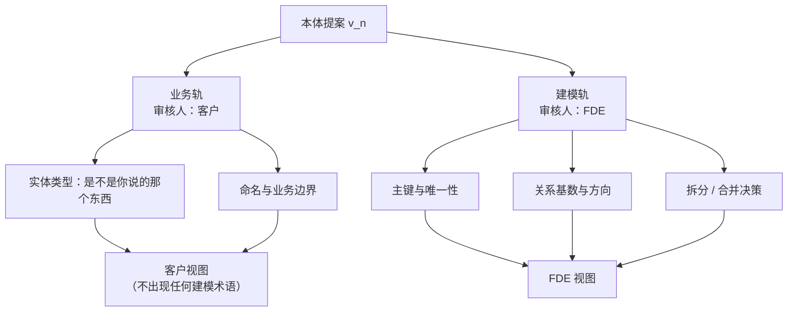
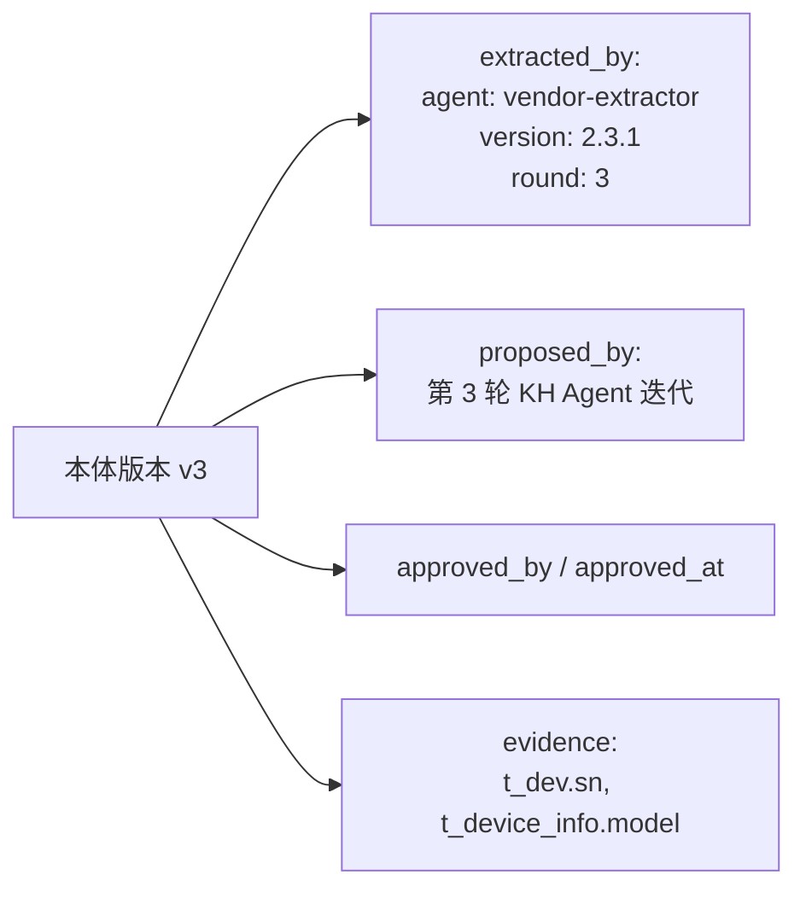
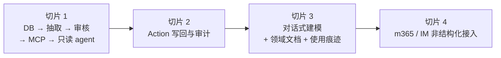

# FDE 本体论平台 · 设计规格

> **本文是本项目唯一的事实源（single source of truth）。**
>
> ⚡ **只看一节就够 → [§0.1 取舍与边界总表](#01-取舍与边界总表)**（核心赌注 / 有意偏离 / 主动放弃 / 红线 / 能力边界 / 风险 / 最大未知）
>
> 任何设计事实、契约、取舍，只在本文件里写一次。其他文档一律是本文的投影：
>
> - **设计** —— 可以是 md，本文件即
> - **汇报** —— 严格用 HTML，见 `docs/reports/`
> - **实现** —— 计划落在 `docs/plans/`，不得与本文冲突
>
> 原始输入在 `input/`（只读，不修改）：第一版架构图 `FDE-本体论-v1.jpg`、会议纪要、Palantir 调研报告。
> 历史版本在 `archive/`，仅供追溯，不作为依据。

| 项 | 值 |
| --- | --- |
| 日期 | 2026-09-28（整合自 2026-09-24 三份文档） |
| 状态 | 待评审 |
| 覆盖范围 | 平台架构、本体核心模型、KH Agent 迭代闭环、MVP 切片 |
| 读者 | 工程师（实现）、FDE（使用）、老板与客户（经 HTML 汇报） |

---

## 0. 三层视图与本文件的对应

本项目对同一套设计有三种读法，面向不同读者。**三者是投影，不是三份独立设计。**

| 视图 | 回答的问题 | 主语 | 载体 | 读者 |
| --- | --- | --- | --- | --- |
| **设计规格（本文）** | 系统是什么、为什么这么定、契约是什么 | 本体 | `docs/design/ontology-platform-spec.md` | 工程师、FDE |
| 能力面 | 平台对外能做什么 | 能力 | `docs/reports/2026-09-24-capability-plane.html` | 老板、客户 |
| 功能面 | FDE 交付时用它做什么 | 交付 | `docs/reports/2026-09-28-functional-plane.html` | 老板、产品、FDE |
| 组件面 | 系统由哪些模块组成 | 实现 | `docs/reports/2026-09-24-component-plane.html` | 工程师 |

**能力面 = 功能面的抽象**（把建拆成四步后的合并视图）。**组件面 = 本文的实现投影**（本文 §4）。

维护规则：

1. 事实变更**只改本文**，随后同步受影响的 HTML 汇报。
2. HTML 汇报里出现本文没有的判断，视为缺陷，以本文为准。
3. 计划（`docs/plans/`）与本文冲突时，改计划。

---

## 0.1 取舍与边界总表

> **本文 1100 行，但下面这张表是全部。** 评审看这一张就够；要动某一条的具体依据，再往下翻到对应小节。
>
> 本表汇总散落全文的**有意偏离、主动放弃的能力、以及必须守住的红线**。它的作用是：**十分钟内能让人知道这套系统在赌什么、赌不起什么。**

### A · 核心赌注

| 赌什么 | 为什么押 | 押不起怎么办 |
| --- | --- | --- |
| **人比 LLM 更会「定义」，LLM 更擅长「发现」** | 让人凭空写出对象类型他写不出来；给一份候选，他一眼能说「这不对，我们管它叫 XX」（§2.3） | 若真实客户连候选都判断不了，说明 §2.3 的前提不成立 —— **这是第一个要验证的假设** |
| **双轨审核能撑住「客户审不了建模、FDE 审不了业务」这个夹缝** | 客户看主键会随便点通过；FDE 替客户判断业务等于没审（§8.3） | 审核退化成盲审 → 证据链失效 → 整条链崩 |
| **收敛可以靠「快照 + 增量 diff + 冻结」保证，而不是靠模型更聪明** | 每轮重新生成必然振荡（§8.4） | 无 |
| **客户签字的判据是「能回答我的业务问题」，不是「有写回」** | 问答价值先于写回价值（§9.3） | **红线：切片 2 不得再顺延** |
| **本体难以跨项目复用，所以不做行业模板** | 只有一个样本时做抽象，抽出来必然是那家客户的怪癖（§2.5） | 做了 5 个同行业项目后再回头归纳（§2.5、§10.4） |

### B · 有意偏离（对外讲解时不必回避）

| 偏离了什么 | 我们的选择 | 理由 | 代价 | 缓释 |
| --- | --- | --- | --- | --- |
| **Palantir 的「动作先行」** | POC 不含写回，推迟到切片 2 | 客户首轮签字判据是问答可用；写回需先解决权限与审计，客户 IT 未授权时硬塞会卡审批（§9.3） | **交付物有沦为昂贵仪表盘的风险** —— 报告警告的失败模式 #4，未消除、只是推迟 | 交付物须含一页纸本体文档 + 决策清单驱动的问答演示（≥5 个业务问题）+ 呈现写回路线 |
| **OWL / SPARQL / SHACL 语义网栈** | 全部不进运行时 | ① **OWA 与封闭世界契约正面冲突**（§6.5）；② 团队仅一人、POC 目标一周；③ Palantir 自身也不用 | 客户已有 OWL 本体时，导入需另做映射 | 内部用 LPG（Palantir 同源），出口处转标准；对照表已备（§6.5） |
| **应用层不推理** | 只读已冻结事实，推理结论一律进提案通道 | 未签字的结论没有责任人；推理直接进查询会拆掉「可测性」（§4.3.1） | 少了「自动推理出答案」的演示效果 | 规则引擎在生产阶段补，结论同样走审核（§6.5） |
| **「涌现」→「抽取」** | 统一用「抽取」 | 「涌现」暗示模型自主发现真相，与「Agent 是提议者」矛盾（§3） | 无 | 术语变更已记档，**勿改回** |
| **抽取能力外置** | 通过 **A2A** 协议调用外部抽取 agent | ① 这是市场已归纳过的方法，不必等我们做满 5 个项目（§2.5）；② 主动让出编排，**换取「验证与决定」牢牢在手**（§7.1） | 引入版本漂移、静默失败、成本不可控、数据出域四类新风险 | 四项强制义务已定：版本冻结 / 失败可见 / 成本闸门 / 出域逐案确认（§7.1、§8.4、§4.2、风险 R13–R16） |

### C · 主动放弃的能力

| 不做 | 理由 | 位置 |
| --- | --- | --- |
| 行业模板 / 跨项目本体引用 | 复用必须后验 | §11 |
| 图数据库强依赖 | 存储是抽象层，切片 1 用 PG | §4.4、§11 |
| 项目内行级权限 | 使用者就是 FDE | §10.2、§11 |
| 实例层实体对齐 | 无底洞。**但切片 1 有降级策略**（收窄单库 + 显式声明） | §2.3、§9.4 |
| 跨系统逻辑编排 | 会退化成 ESB | §11 |
| 客户自助 UI | 客户看的是交付的 agent 应用 | §1.2、§11 |
| 切片 1 的写回 | 见 B 表偏离项 | §9.1、§9.3 |
| 多继承（RDF 支持，我们主动不做） | 企业场景 90% 是树；多继承的菱形歧义成本大于收益 | §4.6 |
| 跨系统回回的自动推导 | 加个字段会静默多写客户系统 | §5.3 |

### D · 必须守住的红线

> 这些不是建议，是**违反即设计失效**的约束。

| 红线 | 违反后果 | 位置 |
| --- | --- | --- |
| **切片 1 必须为 ActionType / Function 占位** | 切片 2 引入时必须改快照契约、diff 引擎、apply、双轨视图 —— 推翻重来 | §4.6、§4.6 占位强制要求 |
| **切片 1 必须为 `parent` / `disjoint_with` 占位** | 同上。层级变更还要改 diff 语义（「重挂子树」而非普通修改） | §4.6 |
| **切片 1 必须为写绑定占位** | 切片 2 要回头改 `ActionTypeSnapshot` | §5.2、计划 Task 3.5 |
| **Agent 不得直接写生产本体** | 平台自我否定 —— 整个可信度地基塌掉 | §2.2、§4.3.1 |
| **所有自动化结论只进提案通道** | 未经签字的语义进入查询 → 「可测性」崩塌 | §4.3.1 |
| **客户视图不得出现建模术语** | 客户读不懂 → 审核流于形式 | §8.3 |
| **阶段 2 证据验证不可外包** | 若连「依据是否属实」都由 agent 自判，「Agent 是提议者」就空转了 | §7.1 |
| **切片 2 写回时身份不确定 → 必须拒绝** | 改错客户生产数据。**这是事故，不是体验问题** | §5.4 |
| **切片 2 不得顺延写回** | 交付物沦为昂贵仪表盘，续约理由消失 | §9.3 |
| **切片 1 不得存在任何可执行写回路径** | 只读闭环的底线 | §9.1、计划完成标准 |
| **一轮抽取内锁定 agent 版本** | 中途换版 = 换了输入，收敛判定作废 | §8.4 |
| **抽取失败不参与收敛判定** | 静默失败会把「什么都没抽」误判成「已收敛」 | §7.1 ⑤、§8.4、§8.5 |

### E · 明确的能力边界（别让人误以为我们能做）

| 做不到 / 做不到那么好的 | 说明 |
| --- | --- |
| **本体不推理** | `disjoint_with` 只是审核提示 + 写入校验 + 导出，**不是推理公理**。不会从「A 与 B 互斥」推出「C 只能是 A 或 B」（§4.6） |
| **应用层不给「大概」** | 命中或明确失败，二值。「这台设备没有工单」我们答「确定没有」，OWL 只能答「未知」（§6.5） |
| **不改非结构化内容** | IM / 文档不可被写回，只能作触发方与证据（§5.7） |
| **不保证跨系统事务** | 不追求「永不不一致」，追求「不一致一定能被发现并列出」（§5.5） |
| **标准导出有损** | OWL 覆盖 3/4 根柱子的前两个 + 全部治理物；**缺口集中在「动作」** —— 语义网里没有这个位置（§6.5） |
| **数据治理不做** | 血缘 / 质量规则 / 元数据目录是另一个产品（§11） |

### F · 16 条风险（详见 §12.2）

收敛性 · 审核疲劳 · 采集器落地阻力 · 抽取质量 · 过度抽取 · 演示导向偏移 · 实体对齐阻塞 · 动作缺失导致仪表盘化 · 写回身份错配 · 静默覆盖人工决策 · 值域错乱 · 多系统不一致 · **外部 agent 版本漂移** · **外部 agent 静默失败** · **成本不可控** · **数据出域超预期**

后四条是写回与外置带来的，**严重程度高于前十二条** —— 前十二条的最坏结果是**交付不达标**，后四条的最坏结果是**改坏客户生产数据**或**无法解释 diff**。

### G · 当前最大的未知

> **LLM 能否从真实客户库抽出客户认得的候选本体 —— 至今零验证。**
>
> 全部计划覆盖的都是确定性工程（版本、diff、状态机、投影），而项目的核心赌注写在第 2 份计划里，一行代码没写。
>
> **治理机制救不了客户不认的本体。** 建议先做 2 天 spike（一个脚本 + 一个 prompt + 一张真实库的 schema 与样本行 → 人工肉眼判断），再决定内核建多厚。见实现计划开头的顺序提示。

---

## 0.2 技术栈决定

> **2026-09-28 决定。** 本节只记录结论与理由，**不约束架构** —— 架构层面的约束在 §4，栈是可替换的实现选择。

### 决定

| 阶段 / 组件 | 技术栈 |
| --- | --- |
| **抽取可行性 spike**（本周，一次性） | **Python** —— 脚本形式，产出是判断不是代码 |
| **产品后端**（本体内核 · connector · 采集器 · 抽取引擎 · mcp-server） | **Rust** |
| **前端构建工具** | **Bun**（仅开发期，**不进运行时**） |
| **前端框架** | **Svelte**（SvelteKit） |

### 三条理由

**1 · spike 必须最快，与产品栈解耦。**

spike 要回答的唯一问题是「LLM 能否抽出客户认得的本体」。**它的产物是一个判断，不是一段代码** —— 因此用任何栈写都不影响产品。Rust 的编译期成本会全部落在「验证核心赌注」这条路上，而它不产生任何产品价值。**结论对任何技术栈都成立。**

**2 · Rust 单静态二进制，直接命中规格 §4.2 的硬要求。**

采集器要求「一条命令部署到客户内网」。Rust 的静态二进制是这件事的最优解；Python 需 PyInstaller / Nuitka 打包，能做但脏。这是 Rust 相对 Python **最硬**的一条优势。

**3 · 前端：Svelte 做审核界面是最优解；Bun 不进运行时。**

Svelte 的编译期特性和响应式语法，在做「表格 + 树 + diff + 确认」这类界面时样板量最小。

**Bun 只作构建工具**：SvelteKit 用 `adapter-static` 构建成**纯静态文件**，运行时不需要 Bun 也不需要 Node，任何静态服务器均可托管。这样既拿到 Bun 的开发期速度，又**不为它的运行时成熟度负责** —— 交付物要跑在客户内网，不引入年轻运行时的风险。

### 明确不做

| 不做 | 理由 |
| --- | --- |
| spike 用 Rust / Bun 写 | 编译期成本会吃掉它的全部价值（见理由 1） |
| 切片 1 采集器做容器化 | **协议未验证就定部署形态，等于把未验证的东西固化进架构**。切片 1 先做成单个可执行程序，协议在真实客户环境跑通后再谈容器 |
| Bun 作为运行时 | 年轻运行时 + 客户内网部署 = 难排查的故障。`adapter-static` 已完全规避 |
| POC 阶段引入 GraphDB | 切片 1 用 PostgreSQL（§4.4）。**别顺手装个 Neo4j 试试** —— 它会以极低边际成本引入一整套与「本体版本冻结」打架的一致性问题 |

### ⚠ 待处理：实现计划与本决定不一致

`docs/plans/2026-09-24-ontology-core-kernel.md`（3625 行）是**按 Python 写的**（SQLAlchemy / Pydantic / pytest），其开头原本标注「技术栈假设待确认」。

**本决定做出后，该计划与产品栈不一致，需重写。** 重写前需明确一件事：**本体内核（存储 · 版本 · diff · 审核状态机）用 Rust 重写，还是保留 Python 作为内核实现、其余用 Rust？**

- **全 Rust** —— 单一栈，采集器与内核可复用类型；代价是 SQLx 替代 SQLAlchemy、异步与所有权模型的学习成本
- **内核 Python + 采集器/接入 Rust** —— 保住现成计划、LLM 编排生态更顺；代价是两个运行时、跨语言契约

> **本节只记录决定，不擅自改写计划。** 重写范围与语言边界由项目负责人确认后再执行。

---

## 1. 背景与定位

### 1.1 要解决的问题

FDE 在客户现场做 AI 落地，普遍卡在同一处：**客户的数据散、口径乱，业务语义只存在于人的脑子里。**

LLM 直连数据库（text-to-SQL）会编造结果，因为没有任何东西约束它"这个世界由哪些东西构成、它们之间是什么关系、能做哪些操作"。本体的作用就是提供这个约束 —— 把 LLM 的语义空间从"任意 SQL"收窄到"本体允许的查询与动作"。幻觉因此从**不可测**变成**可测**：查询要么命中本体，要么明确失败。

### 1.2 定位

三条定位决定了后文所有取舍，有分歧时回看这里：

1. **使用者是 FDE，不是客户的业务人员。** 客户最终看到的是交付出去的 agent 应用，不是平台本身。平台不需要为"客户自助"做设计。
2. **交付以项目为单位。** 平台抽象的是**能力**，不是某个行业的**本体**。一次交付 = 一个项目 = 一套针对该客户抽取出来的本体。
3. **SaaS 优先，私有化部署并存。** 先做 SaaS，架构上为私有化预留同一套组件。

### 1.3 明确不是

- **不是 Palantir Ontology 的平替** —— 不追求多租户 PBAC、connector 生态、Workshop 级低代码应用框架
- **不是知识图谱产品** —— GraphDB 只是本体存储的一种实现，不是架构基石
- **不是 W3C 语义网栈** —— 不把 RDF / OWL / SHACL 推理搬进运行时；标准只在出口处对齐，且有损处已在 §5.5 写明
- **不是数据中台 / ESB** —— 只做语义统一，不做跨系统的逻辑编排
- **不是数据治理平台** —— 不做血缘、质量规则、元数据目录那套

---

## 2. 核心设计主张

以下五条是全部设计决策的依据。

### 2.1 本体是运营层，不是分析层

Palantir Ontology 常被误读成"知识图谱"。它真正的支柱是四件东西：**Object Type（类型化实体）、Link Type（显式关系）、Action Type（唯一写路径）、Function（可执行逻辑）**。关键主张是：本体不只描述世界，它**承载操作并写回世界**。

因此本平台必须保留**写路径**。一个只能读的本体，对客户而言看完演示就没有第二次打开的理由。

> 写路径是**切片 2** 的内容（见 §8），架构上必须预留。切片 1 的偏差及其代价见 §8.3。

### 2.2 Agent 是提议者，不是决定者

本体的全部价值是**成为可信的语义真相源**，而 LLM 的输出具有随机性。**如果 agent 能直接修改生产本体，这个平台就自我否定了。**

所以 KH Agent 产出的是**提案（Proposal）**，带证据链，必须经人审核才能落库生效。

> **这条原则覆盖所有自动化来源，不只 LLM。** 规则推理、OWL 推理、使用痕迹分析做出的语义判断，产物同样只能是提案。见 **§4.3.1 自动判断的产物去向**。

### 2.3 抽取结构，人定义语义

这是本平台与 Palantir 的分野，也是核心产品主张：**实体类型不由用户定义，而由 LLM 从数据中抽取。**

这个方向成立，因为**人对"识别"永远比对"凭空定义"可靠**。让客户白纸黑字写出他的对象类型，他写不出来；但给他一份候选，他一眼能说"这个不对，我们管它叫 XX"。

但必须承认抽取的能力边界：

> **数据能告诉你"有什么"，不能告诉你"这算什么"。**

例：`t_dev`、`t_device_info`、`dev_backup` 三张表，字段重叠但不完全相同。若它们是设备生命周期的三个阶段，应建 **3 个类型 + Link**；若只是历史遗留的冗余拆分，应**合并成 1 个类型**。

**这两种判断所依据的数据长得一模一样。** 决定它的是业务语义，不是数据形态。所以：

- **抽取把发现成本从"几周"压到"几分钟"，但不承担决策责任。**
- 类比：LLM 像考古学家，能从地层里挖出骨头并拼出骨架 —— 这是抽取。但"这是什么物种、要不要进展厅、叫什么名"需要馆长签字。**骨架是抽出来的，物种是定义的。**

另需区分两个不同层次的"抽取"，**不可打包成一个概念**：

- **类型抽取**（§6 讨论对象）：发现"这里有一类东西叫设备"
- **实例抽取 + 实体对齐**（§10.2 风险 R7）：认出"SN-001 这台设备"，并把散落在 DB、文档、IM 里的同一个东西认成同一个实体

实例对齐是另一个工程量级，且是公认的无底洞。**切片 1 不做**，但必须有降级方案（见 §8.4）。

### 2.4 抽象在语义侧收口，不在接入侧

平台上"外部系统皆有抽象"是正确的哲学，但**抽象的位置很关键**。

三类数据源的读取语义本质不同：

- 数据库：schema 内省、增量拉取、CDC
- 文档协作（m365）：分页拉取、解析 Office 格式、抽取正文与结构
- 即时通讯（IM）：拉取消息、按时序/会话聚合、区分群聊单聊

若强行统一成一个 `fetch(): RawRecord[]`，只能把它们各自压扁成扁平记录 —— **文档的段落层级、消息的对话时序会在这一步丢失**，而这些恰恰是 LLM 抽取实体关系时最需要的上下文。

因此：**每个 connector 自由地用最适合自己的方式读，差异由下游的语义映射层消化。统一的是输出（实体 + 关系 + 证据），不是输入。**



### 2.5 复用是后验的归纳，不是先验的设计

FDE 交付以项目为单位，**本体本身大概率不可跨项目复用** —— 每个客户的业务语义都是特有的。

**行业抽象必须是后验的**：做过 5 个同行业项目之后回头看，才知道哪些是行业共性、哪些是那家客户的怪癖。只有一个样本时做抽象，抽出来的必然是那个客户的怪癖。

因此架构上：**不阻碍未来的抽象，但不为它做设计。**

唯一的例外是 §10.4 的"项目快照导出"—— 成本几乎为零，但为将来的归纳留下原料。

#### 复用还有一条现成的路：接入现成的抽取 agent

> **2026-09-28 新增。** 这是对上一条主张的**补充，不是违背**。

§2.5 说「本体不可跨项目复用，复用必须后验」。但**抽取能力**（"怎么从一堆表里认出设备/工单/合同"这个**方法**）是可以复用的，而且**现在就有别人做过**。

接入外部抽取 agent（§7.1）等于：**不必等做完 5 个项目再归纳，市场已经替我们归纳过了。**

**这与本项目一贯的主张同源**：

| | 不可复用 | 可复用 |
| --- | --- | --- |
| 对象 | **本体版本**（产物） | **抽取方法**（方法） |
| 处置 | 每个客户独立，不抽象 | 接现成 agent，或用自己调好的 KH Agent 当起点 |

> §8.1 里「FDE 调的是 KH Agent，不是本体」是同一条线：**方法是资产，产物是负担。**

**唯一的红线不变**：接入的 agent 产出的仍然只是**提案**，要经过我们的验证（§7.1 阶段 2）与双轨审核。**复用别人的方法，不等于复用别人的结论。**

### 2.6 从决策倒推，而不是从数据源扫全

**本条是 2026-09-28 整合时新增的核心主张，源自 Palantir 调研报告的失败模式复盘（`input/Palantir本体论调研报告-完整单一版.html` §7.1–7.2）。**

一条系统的原子单位不是数据记录，而是**决策**。因此抽取范围的起点不是"这个库里有什么"，而是：

> **「你希望操作员下个季度做出什么不同的决策？」**

两种建模起点的对比：

| | 数据源驱动 | 决策驱动（本平台采用） |
| --- | --- | --- |
| 起点 | 接进库，扫全 | 选定 1 条决策工作流 |
| 抽取范围 | 数据源有多少抽多少 | 倒推这条决策需要哪些对象、关系、动作 |
| 类型数量 | 不可控，几十个细碎类型 | 天然小，且每个都能回答一个真问题 |
| 客户审核 | "太多了" → 砍 → "设备呢" | 逐条都能对上业务问题 |
| 收敛性 | 差，边界由数据量决定 | 好，由决策边界决定 |

**落地要求**：FDE 进场后必须先产出一份**决策清单（Decision Inventory）**，至少含一条前置五名的业务决策，抽取范围由它限定。决策清单在平台里落为项目级的一份输入材料（结构见 §7.2）。

这条主张同时是防止 §10.2 风险 R5（过度抽取）的第一道闸门。

---

## 3. 术语表

| 术语 | 含义 |
| --- | --- |
| **Entity Type** | 实体类型（对象类型）。本体的 schema 层，如"设备""工单" |
| **Entity Instance** | 实体实例。类型的具体个体，如"编号 SN-001 的设备" |
| **抽取（Extraction）** | LLM 从输入数据中推导候选实体类型与关系的过程。产物是**提案**，不是既成事实 |
| **提案（Proposal）** | KH Agent 产出的本体变更建议，含证据链，待审核 |
| **快照（Snapshot）** | 某一轮抽取产出的、确定的本体版本 |
| **冻结（Freeze）** | 已审核通过的本体版本。后续抽取只能在其上追加 diff，不可覆盖 |
| **双轨审核** | 业务轨（客户审语义正确性）+ 建模轨（FDE 审建模质量） |
| **数据面 / 控制面** | 数据面 = 实例数据的同步；控制面 = 本体结构的变更。见 §4.3 |
| **决策清单** | 进场时确定本次交付服务哪条决策工作流的输入材料。见 §2.6 |
| **KH Agent** | 知识装载产出的抽取执行体，**被迭代的对象**，不是一次性配置。见 §7 |

> **术语变更记录**：2026-09-24 初版曾用"**涌现**（emergence）"描述抽取过程，后统一改为"**抽取**"。
> 理由：「涌现」暗示模型自主发现了真相，与 §2.2「Agent 是提议者不是决定者」矛盾；「抽取」只承诺捞出候选物，与提案制自洽。**勿改回。**

---

## 4. 系统架构

### 4.1 总体分层



**关键点**：

- `ontology-store` 是**存储抽象**，GraphDB 只是其实现之一。存储可替换，上层无感
- 采集器与平台之间**只传实体+关系+证据**，原始数据留在客户域内
- 元数据通道（使用痕迹）**不进本体**，只喂抽取引擎（见 §5.3）
- `agent-registry` **只服务建侧**，图上没有出边是刻意的。它承载 FDE 反复调整抽取方法的闭环（见 §8）：**注册抽取 agent（自研的与外部的）、锁定版本、记录每轮迭代**。**读本体的外部 agent 不经过它** —— 那些 agent 只经 `mcp-server` 进来消费本体（§4.5）。两者名字里都有 agent，但一个是造本体的、一个是读本体的
- `agent-registry` 既然接入外部 agent（§7.1），**版本锁定就是它的硬职责** —— 详见 §8.4 `extracted_by`

### 4.2 采集层：SaaS 与客户内网的边界

SaaS 在公网，客户数据在内网。**connector 无法直连客户数据源**，这是 SaaS 形态的硬约束。

因此需要**客户侧采集器**：一个轻量容器（目标：一条命令部署），装在客户内网，主动出站连接 SaaS。

职责划分：

- **采集器（客户侧）**：连接数据源、执行连通性测试、驱动抽取、本地标准化为"实体 + 关系 + 证据"
- **平台（SaaS 侧）**：接收标准化结果、语义映射、抽取、本体管理、审核、MCP 暴露

**核心约束：原始数据不出客户环境。** 这条是合规刚需（尤其 IM 内容），也是对客户沟通时的核心话术。

**收益**：私有化部署 = 把 SaaS 整体搬进客户环境，采集器**在两种形态下都复用**（私有化时退化成本地直连，或保留作为隔离层）。一个组件吃掉两种形态，FDE 不必维护两套交付流程。

#### ⚠ 接入外部抽取 agent 后的出域边界

> **2026-09-28 新增。** §7.1 决定外置抽取能力后，**这条约束需要重新划界** —— 因为抽取 agent 可能是客户环境之外的第三方服务。

| | 切片 1（自研抽取） | 接入外部 agent 后 |
| --- | --- | --- |
| 原始数据（表内容 / 文档正文 / 消息） | **不出域** | **不出域**（不变） |
| **schema（表名 / 列名 / 类型 / 注释）** | 出域（到我们平台） | **出域（到第三方）** |
| **样本行** | 出域 | **出域（到第三方）**，且**必须是脱敏样本** |
| 客户话术 | 「原始数据一步不出你们内网」 | **需要改** |

**三种可选处理，按合规强度排序：**

| 方案 | 做法 | 抽取质量影响 | 话术 |
| --- | --- | --- | --- |
| **A · 脱敏出域** | 样本行列名替换、值哈希或截断 | 中等 —— 失去值域信息，类型判断变弱 | 「原始数据不出域，只出脱敏后的结构与样本」 |
| **B · 私有部署抽取 agent** | agent 跑在客户内网 | 无 | 「数据完全不出域」，话术可保 |
| **C · 合同声明** | 第三方列为 **sub-processor** | 无 | 「数据出域至受同等约束的 sub-processor」（**客户 DPA 需更新**） |

> **这不是技术问题，是销售话术与合同问题。** 客户 IT 一定会问「我的表结构发给谁了」。
>
> **建议**：切片 1 走 **A + C**（脱敏 + 合同声明），生产阶段对大客户提供 **B**。**具体方案在切片 1 交接时与客户逐案确认，不在规格里预选** —— 各客户的数据分级要求不同。

### 4.3 数据面与控制面

进入 pipeline 的东西性质不同，**必须分车道**：


|            | 数据面            | 控制面         |
| ---------- | ----------------- | -------------- |
| 频率       | 高频              | 低频           |
| 触发       | 自动（定时/增量） | 人工审核通过   |
| 幂等       | 是，可重放        | 否，有语义后果 |
| 是否需要人 | 否                | **是**         |

**为什么不合并**：混在一条流水线里会出现两个后果 —— 无法区分"哪些变化需要人看"；本体结构一变是否触发历史数据重算变得不可控。

本体变更后的历史数据重抽取，必须在图上**显式表达**（虚线），作为可观测、可审批的动作，不能靠流水线自然流动。

### 4.3.1 自动判断的产物去向 —— 提案通道

> **这是本平台一条覆盖全部自动化来源的架构约束，不只约束 LLM。**

§2.2 确立了「Agent 是提议者，不是决定者」。**本节把它推广到所有自动化来源**：凡是**机器自动做出的语义判断**，其产物一律是**提案**，必须经双轨审核、有人签字，才能进入本体。

| 自动化来源 | 产物 | 去向 |
| --- | --- | --- |
| KH Agent 抽取（LLM） | 候选对象 / 关系 | 提案通道 |
| **规则引擎 / Datalog 推理** | 影响面、归并建议、自动分类 | **提案通道** |
| **OWL 推理（若启用）** | 蕴含结论、`sameAs` 对齐 | **提案通道** |
| 使用痕迹分析（§5.3） | 「两表疑似同一实体」 | 提案通道 |
| FDE 手工调整 | 拆分 / 合并 / 重命名 | 提案通道 |

#### 为什么规则推理也必须走提案通道

一条铁律：**没有任何未被人审核过的自动化结论，允许出现在查询上下文里。**

- 让自动化结论**直接**进查询 → 系统的封闭世界契约（§1.1「查询要么命中本体，要么明确失败」）立刻失效，**可测性崩塌**
- 让自动化结论**先进提案通道** → 封闭世界契约完好，同时白拿自动化的价值

区别不是「信任度」，而是**「谁为这个语义负责」**。未签字的结论没有责任人，Agent 拿它当事实，就是在替一个没人负责的判断背书。

#### 这条约束的三个直接收益

1. **保住可测性** —— 见 §5.5：OWL 的 OWA 与封闭世界正面冲突，这是化解冲突的唯一办法
2. **白拿自动化的价值** —— 自动归类、蕴含发现、跨系统 `sameAs` 对齐，正是最耗 FDE 工时的活
3. **和整个方法论同构** —— KH Agent（§7）是方法、可跨项目复用；本体的版本是产物、不可复用。**自动化产出的「方法」和「产物」之分，对规则引擎同样成立**

#### 典型场景：类型合并时怎么办

§2.3 悬而未决的问题 ——「`t_dev` / `t_device_info` / `dev_backup` 该合并成一个类型，**已经写进去的实例怎么办？**」



**推理的输出变成了有人负责的决策，而不是没人认领的副作用。**


### 4.4 存储抽象

```text
ontology-store（抽象接口）
    ├── GraphDB 实现（Neo4j 等）
    ├── RDBMS 实现（PostgreSQL：JSONB + 邻接表 + pgvector）
    └── 内存实现（测试用）
```

**选型说明**：企业本体的实际查询深度通常 ≤ 3 跳，PostgreSQL 完全够用；GraphDB 的价值在 10 跳以上的深链查询和超大规模图。**切片 1 建议直接用 PostgreSQL 实现**，理由是客户环境里大概率本来就有 PG，少一个中间件就少一个交付障碍 —— 对 FDE 而言，部署阻力是最大的敌人。

### 4.5 接入面（MCP）

`mcp-server` 把本体暴露为标准 MCP 工具，任何 MCP 客户端（Claude Desktop、Cursor、自研 agent）无需 SDK 即可消费。

**这是架构中性价比最高的一环**：不写 agent runtime、不写 SDK、不绑定任何模型厂商，接入面与后端实现完全解耦。

### 4.6 本体核心模型 —— 「本体」到底由什么构成

这是老板说"与本体核心逻辑关联度不足"最直接的落点。**四根柱子 + 三件治理物**：

#### 四根柱子

| 元素 | 关键字段 | 切片 | 说明 |
| --- | --- | --- | --- |
| **对象** ObjectType | `key` · `display_name` · `description` · `aliases[]`（术语别名，见 §6） · `parent`（层级，见下） · `disjoint_with[]`（互斥，见下） · `properties[]`（`name` / `type` / `nullable` / `is_identifier` / `source[]`） | 1 | 一个业务实体。`source[]` 指向它来自哪个系统；`aliases[]` 是客户叫法与数据库字段名的翻译表 |
| **关系** LinkType | `key` · `source_type` · `target_type` · `cardinality` · `semantic` | 1 | `cardinality`：1:1 / 1:N / N:M。`semantic`：has / belongs_to / depends_on / … |
| **动作** ActionType | `key` · `target_object_type` · `parameters[]` · `preconditions[]` · `effects[]`（**字段级写绑定清单，见 §5**） · `permission` · `audit_policy` | **2** | 对本体的写入。`effects[]` 描述"写回哪个外部系统的哪个字段"，不是笼统的"改一下这个对象" |
| **函数** Function | `key` · `signature` · `allowed_types[]` | **2** | 派生属性 / 聚合，不改变状态 |

#### 类的结构：层级与互斥

> **2026-09-28 补充。** 本体核心模型此前把 `ObjectType` 当作**扁平**结构，无法表达「子类」与「互斥」。这两个不是锦上添花 —— 它们是客户表达业务语义时最常用的结构，也是导入任何真实 OWL 本体的最低要求（见 §5.5）。

**层级 `parent` —— 类型之间的「是一种」**



客户几乎必然会说：「设备分机器人和手工的，都是设备。」**没有层级，只能拆成三个平级类型 + 一条 Link —— 而这在语义上是错的**：部件与整体不是「有关系」，是「是……的一种」。

| 决定 | 选择 | 理由 |
| --- | --- | --- |
| 表达方式 | `ObjectType.parent` 指向父类型 | 层级是**类型自身的属性**，不是实例间的关系。放进 LinkType 会让「型」和「例」混淆 |
| 基数 | **单继承**（一个 `parent`） | 企业场景 90% 是树。多继承带来的菱形歧义与查询复杂度，收益远小于成本 |
| 环检测 | **必须**：禁止 A 的父是 B、B 的父是 A | 环会让遍历查询不终止。写入时校验 |
| 继承语义 | **只继承「是什么」，不自动继承「有哪些关系」** | 子类自动获得父类全部 LinkType 会让本体规模爆炸，且审核时看不出边界。**需要显式建模** |

**互斥 `disjoint_with[]` —— 类型之间不能同时成立**

「一台设备不能同时在两个车间」是**关系**层面的基数（`LinkType.cardinality` 已有）；但「在役」和「报废」不能同时成立是**类型**层面的互斥，此前无处安放。

| 决定 | 选择 | 理由 |
| --- | --- | --- |
| 表达方式 | `ObjectType.disjoint_with[]`，类型级声明 | 互斥是「类型对类型」的关系，不是实例对实例的 |
| 切片 1 的作用 | **审核提示 + 导出**，不执行推理 | 详见下方边界说明 |

> **⚠️ 互斥在切片 1 能做什么、不能做什么（诚实说明）**
>
> **能**：① 在双轨审核视图中作为**提示**呈现（「这两个类型互斥，注意」）；② 导出为 OWL 的 `owl:disjointWith`；③ 作为**数据写入时的校验规则**（一个实例同时命中两个互斥类型时告警）。
>
> **不能**：本平台**不做推理**，因此它**不会**自动从「A 与 B 互斥」推出「C 只能是 A 或 B」。那是描述逻辑的活（§5.5）。
>
> **一句话**：`disjoint_with` 在切片 1 是**给人看的**和**给机器校验用的**，不是推理公理。不要因为它存在就以为本体有推理能力。

**这两个字段的层次关系**：`parent` 决定「一个实例查询时能匹配到哪些类型」（向上匹配），`disjoint_with` 决定「一次匹配结果是否自相矛盾」（横向校验）。**前者扩展召回，后者防止误召回。**

#### 三件治理物

| 元素 | 作用 | 切片 |
| --- | --- | --- |
| **版本** Version | 快照与冻结的载体。审核通过的那一刻，产生一个不可变版本 | 1 |
| **提案** Proposal | 变更的原子单位。KH Agent 产出的是提案，不是直接改本体 | 1 |
| **证据** Provenance | 纵切，挂在上述所有元素上 | 1（最小形态） |

#### 四条设计决定

1. **关系独立成表**，不做"实体 + 关系"打包。一旦打包，关系就无法单独携带基数、语义和证据，后面每一次查询和每一次审核都会付利息。
2. **层级是类型的属性，不是关系**（见上）。`parent` 挂在 `ObjectType` 上，不是一条 `LinkType` —— 否则「型」与「例」的界限会糊掉。
3. **ActionType / Function 在切片 1 不实现，但模型必须占位。** 见 §8.3 的强制要求。
4. **证据内建、格式外对齐。** 内部表 + 出口 PROV-O 序列化，两边都要，但**只在出口处付费**（§5.4）。

#### 占位的强制要求（不可省略）

> **切片 1 的存储模型必须为 `ActionType` 与 `Function` 建表并纳入快照契约**，即使无任何业务逻辑。
>
> 理由：本体快照（`OntologySnapshot`）是存储层与领域层之间的唯一数据契约；提案应用（`apply_items`）、快照 diff、双轨视图投影都直接消费它。**若切片 1 不占位，切片 2 引入 ActionType 时必须回头改动快照结构、diff 引擎、apply 逻辑与双轨视图 —— 推翻重来。**
>
> 对应地，本体项目的实现计划 `docs/plans/2026-09-24-ontology-core-kernel.md` 必须包含这两个占位模型（见该计划 Task 3.5）。
>
> **同理适用于 `parent` 与 `disjoint_with`**：二者一旦漏掉，后续补齐要动快照契约、diff 引擎（层级变更是"重挂子树"而非普通修改）、双轨视图（客户看"这是不是一个设备"时需要层级上下文）—— 与 ActionType 属于同一类返工。**切片 1 就要把结构留全。**

---

## 5. 写回设计（切片 2）

> **2026-09-28 新增。** 写回是本体从"知识图谱"变成"运营系统"的分水岭（§2.1），也是全项目**风险最高**的一环。本节只写**设计约束与必须留的结构**，不写表结构与 API —— 值映射、冲突策略等细节待切片 1 实测、看过真实客户数据形态后再定。

### 5.0 一句话

> **回写的对象永远是「某系统里某行的某个字段」，不是「本体」。**
> 本体决定「该改成什么」和「该不该改」，但**落地永远是字段级、带值映射、带身份校验、带冲突检测的操作**。

### 5.1 为什么难的不是「怎么改」，是「改哪个」

一次「把设备状态改为维修中」的动作，设备类映射到三个系统：

| 系统 | 表 | 状态字段 | 值域 |
| --- | --- | --- | --- |
| ERP | `t_erp_device` | `status` | `ACTIVE` / `MAINT` / `IDLE` |
| IoT 平台 | `t_iot_device` | `online_status` | `0` / `1` —— **没有维修状态** |
| MES | `t_mes_tool` | `tool_status` | `RUN` / `MNT` / `STOP` |

四个问题同时冒出来：

| # | 问题 | 后果 |
| --- | --- | --- |
| 1 | **身份对不上** —— `t_erp_device.device_code='D001'` 与 `t_iot_device.dev_id='X99'` 是同一台设备吗？ | **改错别人数据** |
| 2 | **字段不存在** —— IoT 压根没有「维修中」 | 静默丢失或写错字段 |
| 3 | **值域不同** —— 同一个语义要变成 `MAINT` / `(无)` / `MNT` | 编码错乱，对不上账 |
| 4 | **并发** —— 确认的这两秒里，客户可能已在 ERP 手动改成「停用」 | 覆盖人工决策 |

**第 1 与第 4 最要命，第 2 与第 3 最容易忘。**

### 5.2 写绑定：回写的最小单位

读绑定的镜像。我们约定（§4 讨论）读绑定的概念，本节定义其**写**方向：

```
写绑定 WriteBinding
├── 归属        project_id + version_id     ← 随版本冻结，见 §5.6
├── 归属动作     action_key                   ← 哪个 Action 会用这条绑定
├── 目标属性     设备.状态
├── 落地位置     哪个系统 · 哪张表 · 哪个字段
├── 主键表达式   怎么用本体实例定位到那一行
├── 值映射       本体值 → 该系统编码
│     在役   → ACTIVE  /  online=1  /  RUN
│     维修中 → MAINT   /  (不支持)   /  MNT
│     停用   → IDLE    /  online=0  /  STOP
├── 支持的值集合 哪些本体值允许落到这个字段
└── 冲突策略     乐观锁字段 / 失败处置
```

**`effects[]` 因此不再是一句"改一下设备"，而是一串明确的字段级写操作。** 每一条都需人工声明、人工审核、可追溯。

### 5.3 哪些系统被写，必须显式声明

> **不做「按类型自动推导所有绑定」。**

若自动推导，则「给设备加了个状态字段」会**静默地**使某个 Action 从写 2 个系统变成写 3 个。多写 = 误操作客户生产数据。

**显式优于自动**：

- 改本体不会意外多写一个系统
- FDE 明确知道「这个 Action 碰哪几个系统」
- 客户 IT 授权时，面对的是一份具体清单，而不是"设备相关的都写"

### 5.4 身份：写比读严得多

| | 身份不确定时 | 理由 |
| --- | --- | --- |
| **读** | **标注出来**，让用户知道可能是同一条 | 答错了用户能看出来 |
| **写** | **必须拒绝** | 答错是遗憾，**改错别人数据是事故** |

**产品承诺（非技术细节，客户会问）**：

> **切片 1 允许跨库身份不确定**（只读、无损害，且必须带标注）；**切片 2 不允许** —— 跨系统回回必须有确定身份，否则**只允许写回单一系统**。

理由：身份对齐（§2.3）本是无底洞，切片 1 已定降级策略为"收窄到单库"（§8.4）。但**一旦进入切片 2，身份不确定就从"体验问题"升级为"安全问题"**。§8.4 的降级策略**只适用于只读阶段**。

### 5.5 并发与不一致：可检测，而不是假装没有

**跨系统分布式事务做不到，也不该假装做。** 能做的是冲突检测与如实报告。

**① 冲突检测 —— 条件更新（乐观锁）**

```sql
-- 读到的行版本是 42，写回时带上条件
UPDATE t_erp_device
   SET status = 'MAINT'
 WHERE device_code = 'D001'
   AND row_version = 42
```

- 影响 1 行 → 成功
- 影响 0 行 → **有人在我读之后改过，拒绝并报告**

**不是回滚，是如实说"这条没改成，因为数据变了"**，然后作为提案回到人面前（§4.3.1）。

> 在设备运维场景，「最后写的人赢」会造成**很贵的错误**。宁可拒绝，不可静默覆盖人工决策。

**② 三层一致性**

| 层 | 内容 |
| --- | --- |
| ① 本体 | 真相源。冻结版本声明"这台设备是维修中" |
| ② 各系统 | 尽力同步，**逐条记录**写回结果（成功 / 失败 / 冲突） |
| ③ 一致性检查 | 规则扫一遍，列出"本体说 A、ERP 说 B、MES 说 C"的所有不一致 |

第 ③ 层是 Datalog / 规则引擎的天然用途，且其结论**进提案通道**（§4.3.1）—— 不直接改数据，只提示"这 6 台设备三系统状态不一致，要不要修"。

> **原则**：不追求"永远不会不一致"，追求"**不一致一定能被发现，并且能列出来**"。

### 5.6 幂等与审计

| 要求 | 内容 |
| --- | --- |
| **幂等键** | 每次写回带唯一 key。重试**不得**造成重复副作用（如重复派单、重复通知） |
| **完整审计** | 记：谁发起、依据哪个本体版本、写了哪些系统的哪些字段、**旧值与新值**、结果、失败原因 |

审计是对上一节 ③ 的支撑 —— **没有逐条写回日志，一致性检查无从做起。**

### 5.7 非结构化源的位置

客户判断正确：**IM / 文档不能被写回。** 写回要么改数据、要么改内容，后者是协作系统的地盘，不该由本体平台代劳。

但非结构化源有一个正当角色：**触发**。

> 「在群里 @张三 派这张工单」—— 这是一个 Action，**发起方是 IM**，但**写回目标是工单系统**。

| 角色 | 非结构化源 |
| --- | --- |
| 作为**目标** | ❌ 不回写 |
| 作为**触发方** | ✅ 可以，且常是最好的触发场景 |
| 作为**依据** | ✅ 进证据（§5.3 元数据通道），不进本体 |

### 5.8 切片划分

| | 切片 1（只读） | 切片 2（写回） |
| --- | --- | --- |
| 写绑定 | **只留结构，不产出**（同 ActionType 占位） | 产出并经双轨审核 |
| 身份 | 允许不确定，**必须带标注** | **必须确定，否则拒绝写** |
| 值映射 | —— | 显式声明 + 审核 |
| 冲突策略 | —— | 乐观锁 + 冲突报告 |
| 一致性检查 | —— | 规则引擎，结论进提案 |
| 审计 | 最小溯源（§5.4） | 完整写回日志：旧值 / 新值 / 依据版本 / 操作人 |
| 跨系统回写 | ❌ | ⚠️ 需先解决身份对齐，否则只写单一系统 |

**切片 1 现在要做的只有一件：把位置留着** —— 这正是 §4.6「留全结构」原则的延续。

---

## 6. Connector 与输入通道

### 6.1 用能力标签，不做继承树

connector 分类为**结构化 / 非结构化 / 对话式**。这层分类是必要的，但**实现上不建继承树，改用能力标签（capability tag）**。

理由：继承树在运行时会僵化。例如 m365 既有文档（非结构化）又有日历（结构化），在单继承下无法归类。改为每个 connector 声明自己支持的**能力集合**，KH Agent 按能力勾选：

| 能力标签 | 含义 | 典型来源 |
| --- | --- | --- |
| `read_schema` | 读表结构 | 数据库 |
| `read_rows` | 读行样本 | 数据库 |
| `read_text` | 读文本内容 | m365 / 文件 |
| `read_conversation` | 读对话时序 | IM |

好处：新增 connector 不需要修改类型体系；KH Agent 的选装逻辑简化为"勾选能力"。

> **⚠ 口径澄清（2026-09-28 修正）**：
>
> **"读使用痕迹"不是 connector 能力标签。** 本表只有四个标签，**没有 `read_metadata`**。
>
> 使用痕迹（查询日志、报表定义、系统调用痕迹）与 connector 是**平行的两条独立输入通道**，职责不同 —— connector 抽的是本体要描述的对象（进本体），使用痕迹描述的是这些对象在业务里怎么被用（不进本体，只作抽取上下文）。
>
> 详见 §6.3。早期版本曾把 `read_metadata` 列进本表，与 §6.3 冲突，**已于本版统一删除**。

### 6.2 机制约束：一次抽取会话内固定 connector 集合

**connector 集合必须在一次抽取会话开始时固定。** 中途挂载新 connector 等于换了输入，此前的收敛判定作废，须显式开启新一轮迭代。

不加这条约束，"收敛"这个判据就不可信。

### 6.3 元数据通道：使用痕迹不是 connector

**"数据被怎么用"比"数据长什么样"更能揭示语义。** 例：`t_dev` 与 `t_device_info` 在 87% 的查询里都被 join 在一起 → 很可能同一个实体；若从不 join → 很可能是两种东西。这个信号比字段名相似度可靠得多，且免费存在于客户环境中。

但使用痕迹**不适合塞进 connector 分类**（也不是 connector 能力标签，见 §6.1），因为两者职责不同：

- **connector 抽的是本体要描述的对象** —— 设备、工单、合同，**进本体**
- **使用痕迹描述的是这些对象在业务里怎么被用** —— **不进本体**

因此它是与 connector **平行的第二条输入通道**，输出只作为抽取引擎的上下文。

**架构上必须为它留位置**，不能让"所有输入都是 connector"这个假设把路堵死。切片 1 先不做（见 §9）。

### 6.4 溯源 Trace —— 唯一的纵切

溯源不是一项独立能力，**它横跨建/审/用/动**：不是一步操作，而是每个操作都必须写下的属性。

**每个对象类型 / 关系类型 / 动作都挂四个字段**：

- `proposed_by` —— 哪一轮、哪个 KH Agent 提出的
- `evidence` —— 依据哪条数据 / 哪次抽取（回到源证据）
- `approved_by` —— 谁批的（建模轨 / 业务轨分别记）
- `approved_at` —— 何时批的

**两条设计决定**：

1. **内部保持轻量**：自己建表，不引入 RDF / 推理栈。企业本体的实际查询深度通常 ≤ 3 跳，为"理论完备"付的代价在交付现场收不回来。
2. **出口处付审计端的钱**：对外导出时序列化为 **PROV-O**。也就是说 —— 内部是工程实现，对外是标准格式。**只在边界上做转换，不在内部做妥协。**

> 会议明确主流开源实现偏学术化、暂不适配当前需求。这里就是取舍的具体落点：**不把 W3C 那一整套（OWL / SHACL / 确定性推理）搬进运行时，只在出口处对齐标准。**

切片 1 的最小形态：**点开任何一个对象类型，能看见它是哪一轮抽出来的、依据什么**。不需要推理机，不需要图数据库。

### 6.5 标准对照与出口

本节回答一个必然会被问到的问题：**「你们用了『本体』这个词，那你们的本体用标准语言怎么写？」**

答案不是「我们有一层 OWL」，而是：**一张对照表 + 一条出口。** 本节把每个设计元素逐一对到 W3C / 学术标准，**明确标出哪里有损、损在哪、我们主动放弃表达什么。**

> 把有损的地方写在自己的文档里，比等客户在采购评审时问出来要好得多。调研报告里 NHS 那个 3.3 亿英镑案例被议会盯上的理由之一，正是「算法黑盒无法审计、成果不可迁移」。

#### 对照表

| 我们的元素 | 标准对应物 | 无损？ | 缺口与降级策略 |
| --- | --- | --- | --- |
| **EntityType** | `owl:Class` + `rdfs:subClassOf` | 无损 | 本体的**层级**通过 `parent` 映射到 `subClassOf` |
| **`EntityType.parent`** | `rdfs:subClassOf` | 无损 | 单继承（见 §4.6）。RDF 支持多重继承，我们主动不做 |
| **`EntityType.disjoint_with`** | `owl:disjointWith` | 无损 | 但**只在导出时表达**，本平台不做推理（见 §4.6 边界说明） |
| **EntityProperty** | 数据属性 / RDFS literal | 基本无损 | `nullable` / `is_identifier` 不是 OWL 概念 → 归 **SHACL** 表达 |
| **LinkType** | `owl:ObjectProperty` | 无损 | — |
| `cardinality`（1:1 / 1:N） | `owl:FunctionalProperty` | 部分 | N:M 与方向在 OWL 靠 RDF 约定，不是可推理公理；导出时保留为属性特征 + 注释 |
| `semantic`（has / belongs_to） | **无标准对应** | **有损** | 降级为 `rdfs:label` 注释，**不可推理**。**这是本平台比 RDF/OWL 多出来的东西** |
| **Function** | **OWL 没有** → 需 SWRL / Datalog | **有损** | 派生属性与聚合在描述逻辑里无位置 |
| **ActionType** | **OWL / SHACL / SWRL 均无干净对应** | **严重有损** | 写回 + 副作用 + 权限 + 审计，**语义网里根本没有这个位置**。见下方专项说明 |
| **Version** | `prov:Activity` + 版本 IRI | 可表达 | — |
| **Proposal** | `prov:Activity` + `prov:wasGeneratedBy` | 可表达 | — |
| **Provenance 四字段** | **PROV-O 三要素七关系** | 可表达 | `proposed_by` ≈ Activity；`approved_by` ≈ Agent；`actedOnBehalfOf` 正好覆盖「KH Agent 代客户提议」 |
| **证据 Evidence**（表 / 字段） | `prov:wasDerivedFrom` + `prov:used` | 可表达 | — |
| **双轨审核** | PROV 的 Agent 区分业务轨 / 建模轨 | 可表达 | — |
| **决策清单** | **无标准对应** | 有损 | 可建模为 `prov:Entity` + 自定义属性 |

**汇总：OWL 覆盖 3/4 根柱子（对象 / 关系 / 动作中的前两个）+ 3/3 件治理物；PROV-O 覆盖全部治理物。两个合起来约八成，剩余缺口集中在「动作」—— 也就是本平台最核心的差异化。**

#### ActionType 的专项说明

`ActionType` 是四根柱子中**唯一在语义网标准里完全没有位置**的元素：OWL 是描述逻辑，只描述世界、不改世界；SHACL 只做验收、不做副作用；SWRL 虽能表达规则，但把动作写回外部业务系统超出了它的定位。

因此对外表态必须诚实：

> **我们导出的标准本体，表达的是「这个世界由什么构成」，不表达「Agent 能对它做什么」。**
> 后者是我们刻意保留的运营层能力（§2.1），如需保留，请同时保留我们的 ActionType 定义 —— 它无法被 OWL 承接。

这不是缺陷，是取舍的公开化。**动作优先（action-first）是我们与纯知识图谱的分界线，导出时被降级是这一分界线的直接代价。**

#### 为什么不在运行时采用 OWL 推理

**决定：不把 OWL / 描述逻辑推理机放进运行时。** 三条理由，按重要性排序：

**1 · 开放世界假设（OWA）与本平台的核心价值主张正面冲突。**

§1.1 的立身之本是「**幻觉从不可测变成可测：查询要么命中本体，要么明确失败**」—— 这是**封闭世界契约**。而 OWL 的根基是 OWA：**「没有断言 = 未知」，不是「不存在」**。

| | 本平台 | OWL |
| --- | --- | --- |
| 「SN-001 没有关联工单」 | **确定没有** | **未知**（可能有，只是没写） |

若把 OWL 推理机接入运行时、让推理结论直接进查询上下文，传给 Agent 的语义就从「确定」退化成「大概」—— **我们花大力气建立的「可测性」会被 OWA 亲手拆掉**。

> **化解办法不是放弃推理，而是改产物去向。** 按 §4.3.1，OWL 推理的结论只进**提案通道**，经人签字后才进入本体。这样 OWA 的「未知」永远不会泄漏到查询里 —— **自动化照做，封闭世界完好**。

**2 · 在概率性提议者之上叠确定性推理机，会产出「更确定、但同样错」的结论。**

OWL 的已知边界是：建模失误会让推理机推出荒谬结论。而我们的建模是 **LLM 提议、人审核的**（§2.2）。在一个概率性提议者之上叠一个确定性推理机，得到的是**看起来可信、实则同样错**的答案 —— 比现在会错更难发现。

**3 · 成本与团队规模不匹配。** 切片 1 目标一周内可演示，团队仅一人；Palantir 亦明确不使用 RDF/OWL/SPARQL。

#### 真正该用的推理：Datalog / 规则层（生产阶段）

OWA 冲突的根源是**描述逻辑**，不是「推理」本身。调研材料里有一句话点破了关键区别：

> 「确定性推理没有温度参数，没有幻觉空间，**推理路径就是审计证据**。」

我们的卖点恰恰是证据链（§6.4）。**确定性推理与本平台同构，描述逻辑与本平台不同构。**

| | OWL 描述逻辑 | Datalog / 前向链 |
| --- | --- | --- |
| 世界假设 | 开放（OWA） | **默认封闭** ✅ |
| 规则可读性 | DL 公理，面向推理机 | **if-then，面向业务人员** ✅ |
| 递归闭包 | 强 | 强（Datalog 的杀手场景）✅ |
| 能否表达本平台的事 | 只能描述 | 推导、告警、策略闸门 ✅ |

**具体价值举例**：一条 `reachable(X, Y) :- bound_to(X, T), bound_to(Y, T)` 加上影响面查询，就能直接回答 §2.3 悬而未决的问题 —— **「判断 `t_dev` / `t_device_info` / `dev_backup` 该合并成一个类型，已经写进去的实例怎么办？」**

> ⚠ 前提：规则结论**同样只进提案通道**（§4.3.1）。一条确定性规则能算出影响面，不等于它有权决定「这三张表就是同一个东西」—— 那个判断仍然要人来下（§2.3：数据能告诉你「有什么」，不能告诉你「这算什么」）。

结论：**缺的不是 OWL 层，是一条规则层；而且它比 OWL 便宜得多，也更契合「一切都要有证据」的立场。** 规则层不属切片 1，待抽取质量验证（见 §9.5 与实现计划开头的顺序提示）之后再定结构。

#### 出口策略

| 出口 | 阶段 | 说明 |
| --- | --- | --- |
| PROV-O 溯源 | 切片 1 | §6.4 已定：只在此处对齐标准。数据源 = 溯源四字段 + Evidence |
| **SKOS 业务术语表** | POC 后 | 数据源已就位：`ObjectType.name` → `skos:prefLabel`、`ObjectType.description` → `skos:definition`、`ObjectType.aliases[]` → `skos:altLabel`、`ObjectType.parent` → `skos:broader`。**只差一个导出器，建议先做** |
| OWL 本体 | 待定 | 有客户明确要求时再实现；届时照本节对照表实现即可，无需重新设计 |
| SHACL 验收 | 待定 | 与 `nullable` / `disjoint_with` 一起导出 |

> **本节的定位**：它是**沟通资产**，不是运行时组件。成本是一张表，收益是「主动交代有损」而非「被动解释缺陷」。

---

## 7. 抽取机制

抽取（而非搬运）是本平台的核心认知动作 —— 见 §2.6 的决策倒推原则与 §8 的迭代闭环。

### 7.1 编排的边界 —— 外置「怎么想」，不外置「验证与决定」

> **2026-09-28 决定。** 抽取的**生成能力可以外置**，通过 **A2A 协议**调用外部抽取 agent；但**验证与治理不可让渡**。

**完整链路**（与 §7.2 的三条硬约束配套）：

```
阶段 0 · 准备            【纯代码，无 LLM】
  读 schema（表 / 列 / 类型 / 可空 / 主键 / 注释 / 外键）
  采样（每表 N 行，脱敏）
  按表分组
        ↓
阶段 1 · 分组抽取        【外部 agent · A2A 调用】可插拔
  每组一次调用
  输入：schema 片段 + 样本 + 决策清单约束 + 领域提示 + 已有类型清单
  输出：候选类型 + 属性 + 「属性 ← 来源列」的映射声明
        ↓
阶段 2 · 验证            【纯代码】★ 不可外包
  每条声明的表 / 列是否真实存在于 schema？  否 → 丢弃
  采样值是否真的出现在那一列？              否 → 降权
  与已有快照比对，重复？                    是 → 丢弃
        ↓
阶段 3 · 跨组合成        【代码 + agent 判断】
  多组都提了「设备」→ 合并还是分开？
  两张表都有 device_id → 是否提出 Link？
  → 产出「建议」，不是动作
        ↓
阶段 4 · 提案            【纯代码】
  转 ProposalItem，附证据，等双轨审核
```

#### 为什么阶段 2 不能外包

§2.2 确立「Agent 是提议者，不是决定者」。**若连「提议的依据是否属实」都由 agent 自己判定，这句话就空转了。**

外部 agent 说「设备.序列号 ← `t_dev.sn`」，**只有我们的代码去查过 `t_dev` 确实有 `sn` 列，这条证据才成立**。

> **一句话：外置「怎么想」，不外置「想得对不对」。**

#### 编排的五条设计点

**① 让 agent 做「映射」，不要让它做「命名」。**

| 任务 | 强项？ | 后果 |
| --- | --- | --- |
| 「`t_dev` / `t_device_info` 的 `sn`、`model` 列描述的是同一类东西」 | ✅ **模式识别，强项** | 可用 |
| 「这个东西叫什么」 | ❌ 会编出客户不认的名字 | **幻觉** |

> 输出格式从「请你定义这些类型」改成「**请把每一列映射到下列已有类型，或标记为新类型**」。前者开放式，模型会发挥；后者受限、可验证。

**② 分组按表，不按业务域。**

「哪些表属于同一业务域」正是要判断的事 —— 交给 agent 分组就成了循环依赖。**表边界是客观的**，跨表归并留给阶段 3。

**③ 证据必须机器可验证。**

```
agent 声明：「设备.序列号 ← t_dev.sn」
   ↓ 代码核对
t_dev 确实有 sn 列？            ✓
采样里 sn 列的值长这样？        ✓
   ↓ 都成立 → 留下。证据 = (t_dev, sn)
```

**④ 已有类型的 `key` 必须稳定。**

| 做法 | 后果 |
| --- | --- |
| 每轮重新生成 key | 第 2 轮把「设备」抽成「Dev」，diff 显示成「删了设备、加了 Dev」 |
| **key 稳定、只改显示名** ✅ | diff 干净，版本历史可读 |

**`key` 一旦生成就不可变** —— 改名只改 `display_name`。

**⑤ 部分失败必须显式暴露。**

- 结构化输出（JSON schema 约束）大幅降低非法率
- 校验失败 → 重试 1–2 次 → 仍失败则该组标记「抽取失败」，**不静默跳过**
- **收敛判定（§8.5）必须知道哪些组失败了** —— 否则「连续两轮 diff 小于阈值」会把「什么都没抽」误判成「已收敛」

> 这一条在接外部 agent 后**风险更高**：新增了超时、限流、行为变更、悄悄降级等失败模式。**外部 agent 的失败状态必须显式进入提案元数据，且不参与收敛判定。**

#### 外置带来的三个强制义务

外置不是白拿的。以下三项是**外置之后新出现的义务**，规格其余部分没有覆盖：

| 义务 | 为什么 | 落点 |
| --- | --- | --- |
| **agent 版本必须冻结进快照** | 供应商偷偷升模型 → 抽取结果变了，而你不知道为什么。**否则 diff 分不清是「本体演进」还是「agent 换人」** | §8.4 `extracted_by` |
| **失败必须可见** | 静默失败会伪造收敛 | §7.1 ⑤、§8.5 |
| **成本闸门** | agentic loop 的 token 消耗取决于它自己探索多久，**我们无法预估**；且计费在别人体系里 | 抽取轮次超预算即停并上报 |

#### 协议选型

> **2026-10-08 修订**：本地 KH Agent 的形态已实测确定，见 [ADR-002](../../decisions/ADR-002-KH-Agent走ACP-stdio.md)。
> 下表保留原有的「外部 SaaS agent」视角，新增一行本地 agent。

| | 用途 | 状态 |
| --- | --- | --- |
| **A2A**（Linux Foundation） | **agent ↔ agent**，调用**外部 SaaS** 抽取 agent | v1.0 稳定版（2026-03 发布）；150+ 组织支持；官方 SDK 覆盖 Python / JS / Java / Go / .NET |
| **ACP**（IBM，Agent Communication Protocol） | —— | **2025-08 已并入 A2A**，不再是独立协议 |
| **MCP**（Linux Foundation） | **agent ↔ 工具与数据**，外部 agent 经此读本体（§4.5） | 已在用 |
| **ACP**（**Agent Client Protocol**，本地 stdio） | **本地 KH agent**：`ontok` 以客户端身份拉起子进程 `mcode acp`，JSON-RPC 2.0 over **stdio** | **已实现并实证**（REQ-023/024）。⚠️ 与上一行的 **IBM ACP 同名不同物**，引用时必须写全称 |

> **本地 agent 为什么不用 A2A**：A2A 面向「跨组织的 SaaS agent」，需要鉴权、网络与版本协商；
> 我们的 KH agent **就在本机**，以子进程形态存在。stdio + JSON-RPC 省掉了 HTTP/TLS 与跨语言边界，
> **依赖树不变**（`tokio` 加 feature 即可，实测连 feature 都不用加）。
> 握手已实证：`protocolVersion:1`、`agentInfo{name:"minimax-code", version:"0.5.5"}`。
>
> ⚠️ **语言分工不再是问题**：规格原写「A2A 官方参考实现是 Python，spike 用 Python 阻力最小」
> —— 那条推理的前提是 **HTTP**，在 stdio 形态下不成立，Rust 直接用 `tokio::process` + `serde_json` 即可。

> **两条强制义务照旧适用**（见上表「外置编排的三条底线」）：版本冻结、失败可见、成本闸门。
> ACP 自带 `usage_update` 通知，成本闸门的数据源是现成的。

#### 阶段 1 输出契约（2026-10-08 补充）

```
输出：候选类型 + 属性 + 「属性 ← 来源列」的映射声明
      + description / aliases / evidence / rejected_comments / 属性 note / 属性 nullable / 关系候选与证据
```

> **为什么要补这些字段**：规格 §7.1 阶段 4 的字面做法是「**从候选纯代码重建提案**」。
> 早先的阶段 1 契约**不足以支撑重建**（缺描述、别名、证据），导致重建路径不可用，
> 阶段 3+4 只能无条件跑规则管线 —— 于是 `extracted_by` 记的 agent 与 items 的真实来源
> 天然不一致（**静默假溯源**），能力闸门只能靠「声明」不能靠「验证」。
> 补齐后，「产出即提案」从**可声明**变成**可验证**（REQ-022/024）。

⚠️ **但契约不是对所有 agent 都可满足的**。`origin`（名字来源：注释/词表/关系推导）与
`rejected_comments`（低质注释拒用计数）描述的是**规则管线的内部状态**：
前者需要 `known_tables` + `TableNames` 重跑关系推导才算得数，后者需要先有质量门槛。
**黑盒 LLM 没有渠道报告这两项** —— 填了就是编值。
所以能力声明必须是**静态的**（实现的固有属性），而「这份答案是否承载了契约」
是**抽取后守卫**的职责。**不允许能力标签随答案翻转**（那会重造同一个假溯源）。

### 7.2 抽取的三条硬约束

**三条硬约束**：

1. **产出的是提案，不是直接改本体。** Agent 是提议者，不是决定者。
2. **基于上一版做增量，不重新生成。** 每轮都重生成，模型的随机性会让结果来回漂移，永远收敛不了。
3. **一次抽取会话内，connector 集合固定。** 中途换输入，此前的收敛判定作废。

> **历史术语**：这三个约束所在章节曾名为"涌现"，2026-09-24 统一改为"抽取"，理由见 §3 术语变更记录。

#### 抽取时必须一并产出的东西（易漏项）

> **2026-09-28 补充。** 除了对象与关系，抽取还有两项产物**极易被漏掉**，但漏掉后要么无法收敛、要么无法导出：

| 产物 | 为什么不能漏 | 属于哪个通道 |
| --- | --- | --- |
| **术语别名** `aliases[]` | 客户说「设备」，他们库里可能叫 `t_dev` / `t_machine` / `机台`。**别名是「客户的话」与「数据库的词」之间的翻译表**，而它恰好是 SKOS 导出的直接数据源 | 提案 |
| **决策清单关联** | 每个被抽出的类型，必须能追溯到决策清单里的哪一条决策（§8.2）。**没有这条关联，就无法判断哪些类型是「超范围」的** —— 过度抽取这道闸门就失效了 | 提案 |

> `aliases[]` 是一个**近乎零成本**的补充：它不改变任何架构，只是让 `ObjectType` 多一个字段；但它同时解决两件事 —— 抽取时帮 FDE 对齐客户的叫法，导出时直接就是 SKOS 的 `altLabel`。

---

## 8. KH Agent 迭代闭环

KH Agent 的定位：**本体抽取辅助**。它不定义本体，负责产出候选。

### 8.1 闭环流程



**关键设计：FDE 调的是 KH Agent，不是本体。**

若 FDE 直接改本体，会撞上两堵墙：下一轮抽取会重新生成，改动被覆盖；且本体是客户特有的，跨项目复用不了。

而 KH Agent 里装的是"**怎么从一堆表里认出设备/工单/合同**"这套方法 —— **方法是跨项目可复用的**。第二个同行业客户可以直接拿第一个客户调好的 KH Agent 当起点（注意：这是能力层复用，不是本体复用，见 §2.5）。

### 8.2 决策清单

进场第一件事，产出一份决策清单，**限定本次抽取的范围**。最小结构：

| 字段 | 说明 |
| --- | --- |
| 业务决策 | 客户想改善的决策，一句话，用业务语言（不用表名） |
| 谁做 / 何时做 | 决策人角色、频次 |
| 当前基线 | 现在这件事怎么做的、耗时多少、错率多少 |
| 需要的信息 | 做这个决策要看哪些信息（→ 对象/属性/链接草案） |
| 遵循的规则 | tribal knowledge，老员工脑子里的（→ Function 清单） |
| 决策后谁执行 | 写到哪个系统、错了谁负责（→ ActionType 草案） |

最后三行是决策清单与"数据源清单"的根本区别 —— 它把 §4.6 的四根柱子一次性点齐。

**决策清单是抽取范围的唯一依据**：决策清单里没提到的数据源字段，本轮不抽。这是防止过度抽取（§11.2 风险 R5）最有效的一道闸门。

### 8.3 双轨审核

客户没有能力判断建模质量（主键、基数、规范化），让他审这些他只会随便点"通过"。因此拆成两轨：



**同一版本体，两个视图。** 客户看到"这些是我认识的设备吗"，FDE 看到"这个本体建对了吗"。客户视图中不得出现主键、外键、基数等建模术语。

**评审强度随阶段变化**，见 §9.2。

### 8.4 版本化：快照 / diff / 冻结

这是闭环能**收敛**的保证。

若每轮都**重新生成**，LLM 的随机性会让结果漂移：客户看到 3 个类型说"太多"，下一轮看到 1 个说"太少"，来回振荡不收敛。

正确机制：

1. **快照**：每轮抽取的结果落库，带版本号
2. **diff**：下一轮是"**基于上一版快照 + 新反馈，产出 diff 提案**"，不是重新生成。客户对比的是增量，不是两个全新产物
3. **冻结**：审核通过的部分冻结，后续抽取只在其上追加，不可覆盖

这样"迭代"才真正是**累积**，而不是反复洗牌。

同时，每个新抽取的类型/属性**必须携带证据**（"从哪几张表的哪几个字段推断而来"），否则人无法有效审核，双轨审核会退化成盲审。

#### 快照必须记录 `extracted_by`（agent 标识 + 版本）

> **2026-09-28 新增。** 接入外部抽取 agent（§7.1）后新增的强制字段。

**问题**：agent 版本会漂 —— 供应商悄悄升了模型，抽取结果就变了，而你不知道。

**解法**：一轮抽取用了**哪个 agent 的哪个版本**，与本体版本**一起冻结进快照**：



| 字段 | 记什么 | 为什么 |
| --- | --- | --- |
| `extracted_by.agent` | agent 标识（自研 `kh-core` 或外部 `vendor-extractor`） | 知道是谁抽的 |
| `extracted_by.version` | **具体版本号**，不是"最新版" | **否则 diff 变了分不清是「本体演进」还是「agent 换人」** |
| `extracted_by.round` | 第几轮抽取 | 与 `proposed_by` 对应 |
| `extracted_by.failed_groups` | 本轮**抽取失败**的分组列表 | **失败必须显式，且不参与收敛判定**（§7.1 ⑤、§8.5） |

> **`extracted_by` 与 `proposed_by` 的分工**：`proposed_by` 记的是「这一轮提案是谁提的」（人 / KH Agent），`extracted_by` 记的是「候选是谁生成的」（哪个 agent 的哪个版本）。**外置之后这两者可能来自不同主体，必须分开记。**

#### 新版本取什么值（ADR-001，2026-09-30 已定）

> **`apply(proposal) → new_version` 时，新版本原样取提案的 `extracted_by`；提案没有则记 `null`（人工修订）。不继承、不推断。**

| 场景 | 结果 |
| --- | --- |
| 新一轮抽取（agent 换了版本） | 提案带新版本号 → 新版本如实记录，**agent 升级可见** |
| 人工修订 | 提案带 `agent: null` → 如实表示「这版有人工成分」 |
| 混合提案 | 提案怎么声明就怎么记，**不猜** |

**演进链不由 `extracted_by` 承担** —— 版本父子关系由 `seq` 与父版本承担；想查 v2 怎么来的，看 v1 自己的 `extracted_by`。
「一律继承」被否掉，因为 agent 换人将不可见（正是本节要防的问题）。详见 [ADR-001](../../decisions/ADR-001-extracted-by-policy.md)。

**由此产生一条硬性要求**：

> **一轮抽取一旦开始，agent 与其版本在整个抽取会话内锁定（§7.2 约束 3 已规定 connector 集合固定，agent 版本同理）。** 中途换版本 = 换了输入，此前的收敛判定作废。

### 8.5 终止条件

没有终止条件，这个循环就是无底洞 —— FDE 会永远觉得"再调一版会更好"。三个信号，**任一满足即可收**：

1. **覆盖率**：数据源中有多少字段/表被映射进本体，未映射率降到阈值以下
2. **稳定性**：连续两轮抽取的 diff 小于阈值（已收敛）
3. **验收**：客户签字

> 数值阈值待切片 1 实测后校准，不在本规格中拍定。

**认知对齐**：不存在"正确的本体"，只有"够用的本体"。本体是工具不是真理 —— 目标是"让 agent 能可靠回答客户的问题"，不是"完美刻画客户的业务"。

---

## 9. MVP 范围与切片

### 9.1 切片顺序

按"多快能证明价值"排序，而非按功能完整性。



**切片 1：只读闭环（目标：一周内可演示，且真能用）**

- 仅支持一种数据源（PostgreSQL / MySQL）
- LLM 内省表结构 + 真实行样本 → 生成候选本体 → 双轨审核 → 落库
- `mcp-server` 暴露查询工具
- Claude Desktop 接上即可提问

**为什么把非结构化（切片 4）放最后**：**实体对齐（entity resolution）是无底洞** —— 把文档里的"张三"对到数据库里的员工记录，这件事能让人陷进去数月。切片 1 已能证明价值，不必陪它一起沉。

**为什么 Action（切片 2）先于非结构化（切片 4）**：Action 是"运营层"的分水岭（客户续约的理由），且实现成本远低于实体对齐。

### 9.2 POC 与生产的两种开启深度

同一套功能，两种开启深度 —— **不是两套系统，也不维护两套交付流程**。

| 维度 | POC 阶段（切片 1） | 生产落地阶段 |
| --- | --- | --- |
| 目标 | 证明「能跑通、真能用」 | 正式交付并持续运营 |
| 人员 | **1 个 FDE 即可**，无建模专家要求 | 专门团队（含语义建模） |
| 数据 | 局部必要验证数据 | 全量 |
| 项目 | 单项目 | 多项目并行 |
| 系统接入 | 单数据源，一类 connector | 多源，多类 connector |
| KH Agent | 单个 | 多个，分域 |
| 抽取范围 | 决策清单限定（§2.6） | 决策清单 + 全量补充 |
| 本体模型 | 对象 + 关系（动作/函数**占位**） | 对象 + 关系 + **动作 + 函数** |
| **双轨审核** | **建模轨 FDE 全责 + 业务轨可代签**（客户须过目，§9.2） | **双轨，客户与 FDE 各自独立签字** |
| 收敛冻结 | 轻量：覆盖率达标 + 客户认可 | 双阈值 + 客户正式签字 |
| 本体服务 | 只读 MCP | 只读 + **Action 写回 + 权限 + 审计** |
| 溯源 | 最小形态：点开类型能看见来源 | 完整证据链，出口对齐标准格式 |
| 交付物 | 一页纸本体文档 + 能问答的 Agent | 正式本体 + 可写回的业务闭环 |

#### 切片 1 的审核规则（唯一口径）

> **⚠ 2026-09-28 修正。** 早期版本曾要求"客户能在业务轨独立完成审核，无需 FDE 解释建模概念"，与会议"不得设置过高人员能力要求"直接冲突，且与能力面/功能面的"单轨代签"矛盾。**现统一为：**

1. **建模轨（FDE）：必须完整执行。** 主键、基数、拆分合并由 FDE 自己审，FDE 对建模质量负全责。
2. **业务轨（客户）：POC 阶段可由 FDE 代签。** 但客户**必须看**提案并有机会提出异议 —— 不是免审。
3. **客户签字是收敛冻结的必要条件之一**（§8.5 信号 3）。交付完成的判据不在 FDE 自己的感觉里。
4. **FDE 代签时必须显式记录"已代签"及依据**，不得静默跳过。

生产阶段升级为：客户与 FDE **各自**独立签字，谁也不能替谁签。

**「动作」和「完整溯源」在切片 1 不实现，但位置必须留着** —— 否则生产阶段要推翻 POC 重来（§4.6 占位强制要求）。

### 9.3 与「动作先行」的有意偏离

> **⚠ 2026-09-28 新增。** Palantir 调研报告（`input/Palantir本体论调研报告-完整单一版.html` §6.4）把"交付没有动作类型的应用——造出昂贵的仪表盘，把写回问题留给永远不会被资助的二期"列为五大失败模式之一，并主张"**动作先行**：首个版本就必须包含至少一个带写回的动作类型，否则交付物退化为昂贵仪表盘"。

**本项目在切片 1 明确偏离该主张，Action 推迟到切片 2。这是有意识的决策，不是遗漏。**

| | 说明 |
| --- | --- |
| **理由** | ① 客户首轮签字的判据是"能回答我的业务问题"，问答价值先于写回价值；② 写回必须先解决权限与审计（§9.1 切片 2），POC 阶段客户 IT 未授权时硬塞写回会卡在审批上；③ 写回的信任建立需要客户先见过"只读也答得好"，反序会更快获得授权 |
| **代价** | POC 交付物**有沦为昂贵仪表盘的风险** —— 这是报告警告的失败模式 #4，本项目并未消除它，只是推迟 |
| **缓释** | 切片 1 交付物必须包含：① 一页纸本体文档；② **决策清单驱动的问答演示**（能回答 ≥5 个客户级业务问题）；③ 交付时向客户明确呈现"下一步能写回什么"的能力路线 |
| **红线** | **切片 2 不得再次顺延。** 若切片 2 无法启动，必须回到本规格重新评估是否收缩本体范围，而不是把 Action 永久推迟 |
| **记录** | 本条同时是对 2026-09-24 会议纪要"生产落地阶段再开展正式语义建模"的直接落实 |
| **切片 2 开工前必读** | **§5 写回设计** —— 尤其是 §5.4「写比读严」这一条产品承诺，以及 §5.3「哪些系统被写必须显式声明」。这两条决定了切片 2 的数据结构，不是实现细节 |

### 9.4 实体对齐的降级方案

切片 1 不做实例层实体对齐（§2.3），但必须预先约定遇到该问题怎么办，否则会在客户现场临时决策。

**降级策略：单库优先 + 显式声明。**

1. **切片 1 的客户现场若只有一个数据源** → 不触发该问题，正常推进。
2. **若客户主库与业务库对同一实体（如"设备"）定义不一致** → **本轮不做跨库对齐**，改为：
   - 抽取范围**收窄到决策清单涉及的那一个库**（§2.6 的闸门在此再次生效）
   - 在交付物的一页纸本体文档中**显式列出**"本轮未解决的实体边界问题"，写明是哪两个源、对哪类实体、冲突在哪
   - 该问题转为**生产阶段的立项输入**，不是 POC 的阻塞项
3. **禁止的做法**：为了让问答跑通而在 POC 阶段临时用规则硬合并两个源 —— 这会造出一个客户不认的本体，且违反 §2.2「Agent 不能直写本体」。

**这条是 §11.2 风险 R7 的缓解措施。**

### 9.5 切片 1 验收标准

- 输入：一个**真实客户**的 PG/MySQL 数据源（非构造数据）
- 已有**决策清单**（§8.2），且本体范围可追溯到它
- FDE 在**一个工作日内**产出第一版本体提案
- 每个类型/属性提案**携带证据**
- 建模轨审核由 FDE 完整执行；业务轨按 §9.2 规则完成（代签须留痕，客户须过目）
- 审核通过后，Claude Desktop 经 MCP 连接，能回答**至少 5 个客户级业务问题**
- 覆盖率达到阈值（数值待校准）
- 切片 1 **不要求**客户独立完成建模轨，不要求 Action 写回

---

## 10. 项目与部署形态

### 10.1 两种形态

- **SaaS（优先）**：平台部署在公网，客户侧只装采集器
- **私有化部署**：整套平台搬进客户环境，采集器复用于本地直连或保留作隔离层

两者共用同一套组件，**不维护两套交付流程**（见 §4.2）。

### 10.2 项目是一等公民

SaaS 上会并行运行多个客户项目，**项目间必须强隔离**。

准确表述：**项目之间强隔离（安全刚需），项目内部不做细粒度权限（使用者是 FDE，省掉）。**

因此需要 `Project` 作为架构中的一级概念，所有本体、KH Agent 配置、数据连接、迭代记录、决策清单均归属某个项目。

### 10.3 平台能力 vs 项目产物

这条线必须画清楚：

|      | 平台能力（跨项目，越强越好）                                                         | 项目产物（项目内，互不相干）                    |
| ---- | ------------------------------------------------------------------------------------ | ----------------------------------------------- |
| 内容 | connector 库、抽取引擎、双轨审核界面、mcp-server、存储抽象、pipeline、agent-registry | 该客户的本体、KH Agent 配置、数据连接、迭代记录、决策清单 |
| 归属 | 平台                                                                                 | 单个项目                                        |

**"复用"的位置由此自动清晰**：复用在能力层（connector 支持的数据源越多、抽取引擎越准，每个新项目越省力），不在产物层。

### 10.4 项目快照导出

**唯一为未来预留的东西**：一个项目交付完成后，其本体（含版本历史与证据链）能**一键导出为结构化文件**。

成本几乎为零，但将来做行业归纳时，手上会有 N 份真实样本。**不做更多**（见 §11）。

---

## 11. 明确不做

> ### ⚠ 先分清三种「不做」
>
> | 语义 | 含义 | 记在哪 |
> | --- | --- | --- |
> | **永久不做** | 有明确取舍理由，**不要因为"顺手"而加回来** | **本节** |
> | **MVP 暂缓** | 现在没排上，**后面要做** | 实施计划的「暂缓」表，**每条标注何时补回** |
> | **暂不判断** | 信息不足，等某次实测/客户确认再定 | 风险表或待定项 |
>
> **本节只收「永久不做」。** 不要把实施计划里的暂缓项搬进来 —— 搬进来就等于永久砍掉。

以下均已在讨论中确认排除，**不要因为"顺手"而加回来**：

| 不做 | 理由 |
| --- | --- |
| 本体模板系统 / 行业包 / 类型继承 / 跨项目本体引用 | 复用必须后验（§2.5） |
| 图数据库强依赖 | 存储是抽象层，PG 足够（§4.4） |
| 项目内的行级权限 | 使用者是 FDE（§10.2） |
| 流式/实时处理 | 交付场景先做批 |
| 跨系统逻辑编排 | 会退化成 ESB，平台只做语义统一 |
| 面向客户业务人员的自助 UI | 客户看的是交付的 agent 应用（§1.2） |
| 实例层的实体对齐 | 无底洞，另行立项（§2.3，降级方案见 §9.4） |
| Git 式本体分支/合并 | 双轨审核 + 快照 diff 已够用（§8.4） |
| 数据血缘 / 质量规则 / 元数据目录 | 是数据治理平台的范围 |

---

## 12. 待定项与风险

### 12.1 待定

- 收敛阈值与覆盖率阈值的具体数值（切片 1 实测校准）
- 抽取引擎的模型选型与 token 成本估算
- 使用痕迹采集的具体形式（切片 3 细化）
- m365 connector 的认证复杂度（切片 4 前评估）
- 采集器在客户内网的部署方式（容器 / 二进制）
- SaaS 数据合规边界：哪些数据绝对不出客户环境（已定原则，待形成清单）
- 是否 `git init` 本仓库

### 12.2 风险

| 风险 | 说明 | 缓解 |
| --- | --- | --- |
| **R1 收敛性** | LLM 随机性导致迭代振荡 | 快照 + diff + 冻结（§8.4） |
| **R2 审核疲劳** | 客户看多轮后随便点"通过" | 双轨审核降认知负担；限制轮次；决策清单缩小每轮审查面（§2.6） |
| **R3 采集器落地阻力** | 客户 IT 部门审批慢 | 一条命令部署；最小权限；明确数据不出域 |
| **R4 抽取质量** | 缺领域文档时易猜错 | 切片 3 补领域文档与使用痕迹 |
| **R5 过度抽取** | LLM 产出几十个细碎类型 | **决策清单限定范围（§2.6，第一道闸门）**；给约束：业务域边界 + 粗粒度优先 |
| **R6 演示导向偏移** | 为演示效果做假数据，掩盖真问题 | 验收标准强制要求真实客户数据源（§9.5） |
| **R7 实体对齐阻塞**（新增） | 客户多源对同一实体定义不一致，本体继承分歧为重复对象，问答给出错误结果 | 切片 1 不做对齐；**按 §9.4 降级**：收窄到单库 + 在交付物显式声明未解边界 + 转生产阶段立项；禁止临时硬合并 |
| **R8 动作缺失导致仪表盘化**（新增） | 切片 1 无写回，交付物沦为昂贵仪表盘（Palantir 失败模式 #4） | 已在 §9.3 明示偏离与缓释；**切片 2 不得顺延**是红线 |
| **R9 写回身份错配**（新增） | 跨系统回回时把不同实体认成同一个，**改错客户生产数据** | **写比读严**：身份不确定 → 拒绝写（§5.4）；切片 1 允许不确定身份但必须带标注，切片 2 必须先解决对齐，否则只写单一系统 |
| **R10 静默覆盖人工决策**（新增） | 并发写回覆盖掉客户刚做的操作 | 条件更新 + 乐观锁，影响 0 行即拒绝并报告（§5.5）；**宁可拒绝，不可静默覆盖** |
| **R11 值域错乱**（新增） | 同一语义在三个系统三种编码（`MAINT` / `MNT` / 无），写错后对不上账 | 写绑定**显式声明值映射并经双轨审核**（§5.2）；不支持的值在写绑定里标为不可写，不做隐式转换 |
| **R12 多系统不一致**（新增） | 事务性不可能，部分成功导致三系统状态打架 | 不追求消除，只追求**可检测**：逐条写回日志 + 规则引擎列出一致性检查结论，结论进提案通道（§5.5） |
| **R13 外部 agent 版本漂移**（新增） | 供应商悄悄升级模型 → 抽取结果变化，diff 无法解释 | 快照记 `extracted_by`（agent + **具体版本**）；一轮抽取内锁定版本，中途换版则收敛判定作废（§8.4） |
| **R14 外部 agent 静默失败**（新增） | 超时 / 限流 / 行为变更 / 悄悄降级 → **静默失败伪造收敛** | 失败状态显式进提案元数据（`extracted_by.failed_groups`），**不参与收敛判定**（§7.1 ⑤、§8.4） |
| **R15 成本不可控**（新增） | agentic loop 的 token 消耗由它自己探索深度决定，我们无法预估，且计费在第三方 | 抽取轮次设**预算闸门**，超预算即停并上报，不等它烧完（§7.1） |
| **R16 数据出域超预期**（新增） | 外部 agent 意味着 schema 与样本行出客户内网，**与「原始数据不出域」的核心话术冲突**，客户 IT 会追问 | 三种处理（脱敏出域 / 私有部署 / 合同 sub-processor）逐案确认；客户话术需相应调整（§4.2） |

---

## 13. 附录 A：与原始架构草图的差异

原始草图见 `input/FDE-本体论-v1.jpg`。

| 草图 | 本设计 | 原因 |
| --- | --- | --- |
| connector 直连平台 | 增加客户侧采集器 | SaaS 在公网，连不上客户内网（§4.2） |
| GraphDB 作为平台外挂存储 | 降级为 ontology-store 的一种实现 | 存储是抽象层，PG 优先（§4.4） |
| pipeline 单一 | 拆数据面 / 控制面 | 性质不同，混用不可控（§4.3） |
| 无写路径 | 预留在切片 2，且模型占位 | 否则退化为只读字典（§2.1、§4.6） |
| 无审核环节 | 增加双轨审核 + 提案制 | Agent 不能直写本体（§2.2、§8.3） |
| 无项目概念 | 项目为一等公民 | SaaS 形态下的隔离刚需（§10.2） |
| 抽象在接入侧 | 抽象移到语义侧 | 输入模态的差异是本质的（§2.4） |
| 无范围限定 | 增加决策清单入口 | 防止过度抽取，倒推比扫全更接近交付价值（§2.6） |

## 14. 附录 B：整合记录

本规格由三份 2026-09-24 文档整合而成（原件见 `archive/`）。整合时做出的判断：

| # | 处置 | 位置 |
| --- | --- | --- |
| 1 | 新增「从决策倒推」主张，补决策清单结构 | §2.6、§8.2 |
| 2 | **删除 connector 能力标签 `read_metadata`**，统一到"使用痕迹是平行通道"口径 | §6.1、§6.3 |
| 3 | 切片 1 审核门槛统一为"可单轨代签 + 客户须过目 + 签字为冻结必要条件" | §9.2 |
| 4 | 新增本体核心模型章节（原分散于能力面），并加占位强制要求 | §4.6 |
| 5 | 明示与 Palantir「动作先行」的有意偏离、代价、缓释与红线 | §9.3 |
| 6 | 新增实体对齐降级方案 | §9.4 |
| 7 | 新增风险 R7、R8 | §12.2 |
| 8 | 术语"涌现"→"抽取"统一，并记录理由 | §3 |
| 9 | 决策清单纳入项目产物 | §10.2、§10.3 |
| 10 | 溯源四字段从能力面收进设计规格 | §6.4 |
| 11 | **新增「标准对照与出口」**：逐元素对照 W3C / PROV-O / SKOS，标明有损处与降级策略；给出不采用 OWL 运行时的三条理由（核心是 OWA 冲突）；指明真正该用的推理是 Datalog / 规则层而非描述逻辑 | §6.5、§1.3 |
| 12 | **新增「自动判断的产物去向」**：把「Agent 是提议者」推广到**所有自动化来源**（规则推理 / OWL 推理 / 使用痕迹分析），一律只进提案通道。这是化解 OWA 冲突、保住封闭世界契约的办法 | §4.3.1、§2.2 |
| 13 | **补齐类的结构**：`ObjectType` 增加 `parent`（层级，单继承 + 环检测）与 `disjoint_with[]`（类型互斥），并明确互斥在切片 1 只是审核提示与校验规则，**不是推理公理** | §4.6 |
| 14 | **补齐易漏产物**：`ObjectType.aliases[]`（术语别名）与「类型↔决策清单」的关联。前者是 SKOS 导出的直接数据源，后者是防过度抽取的闸门 | §7 |
| 15 | 明确存储范式为 **LPG**（非 RDF），与 Palantir 同源；OWL/SPARQL/SHACL 不进运行时 | §4.6、§6.5 |
| 16 | **新增「写回设计」整节**：写绑定作为回写最小单位；**哪些系统被写必须显式声明**（不做按类型自动推导）；**写比读严**（身份不确定即拒绝）；乐观锁冲突检测 + 三层一致性；幂等与完整审计；非结构化源只做触发方不做写回目标 | §5 |
| 17 | 新增风险 R9–R12：写回身份错配、静默覆盖人工决策、值域错乱、多系统不一致 | §12.2 |
| 18 | **决定：抽取能力外置**。通过 A2A 协议调用外部抽取 agent，但**阶段 2 证据验证与阶段 4 治理不可让渡**。含四阶段链路、五条编排设计点、三项外置义务、协议选型（A2A / ACP 已并入 / MCP 互补） | §7.1 |
| 19 | 快照新增 `extracted_by`（agent 标识 + **具体版本** + 轮次 + 失败分组）；一轮抽取内锁定 agent 版本 | §8.4 |
| 20 | `agent-registry` 职责扩为「抽取 agent 注册与**版本锁定**」（自研与外部并列） | §4.1 |
| 21 | 新增外部 agent 情形下的**出域边界与客户话术**（脱敏出域 / 私有部署 / 合同 sub-processor 三方案，逐案确认） | §4.2 |
| 22 | §2.5 补充：复用除「后验归纳」外，还有「**接现成抽取 agent**」这条现成路径；红线不变 —— 复用方法不等于复用结论 | §2.5 |
| 23 | 新增风险 R13–R16：agent 版本漂移、静默失败、成本不可控、数据出域超预期；红线表增 3 条 | §12.2、§0.1 |

*配套汇报件：`docs/reports/` 下三份 HTML（组件面 / 能力面 / 功能面），为本文的投影。*
*实现计划：`docs/plans/2026-09-24-ontology-core-kernel.md`。*
