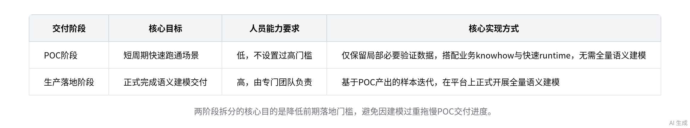

# 智能纪要：本体业务架构专项对齐会议 2026年9月24日

> 会议主题：本体业务架构专项对齐会议
> 
> 会议时间：2026年9月24日（周四） 14:57 \- 15:13 （GMT\+08）
> 
> 参会人：@马永根@张惠磊@张玮
> 
> 

> 智能会议纪要由 AI 生成，可能不准确，请谨慎甄别后使用
> 
> 

# 总结

本次会议由张玮、马永根二人就本体相关业务架构、交付路径及当前工作优先级开展专项对齐，内容如下：

- **当前阶段工作原则与技术选型**

    - **阶段目标**：张玮提出当前无需过度纠结开源组件的实现逻辑、映射规则等细节，核心要务为保障小袁、慧里侧的交付落地。

    - **开源方案参考**：张玮提及当前主流开源实现为 semantic，后续将同步架构要点、现实映射相关材料供参考，明确其偏学术化暂不适配当前需求。

- **交付路径与架构设计共识**

    - **分阶段交付规则**

        - 阶段划分逻辑：张玮明确交付分两步推进，POC 阶段采用轻量模式快速跑通场景，生产落地阶段再由专门团队开展正式语义建模。

        - 人员门槛控制：明确 POC 阶段不得设置过高的人员能力要求，避免因前期建模过重导致 POC 无法在短周期内完成落地。

    - **落地与迭代机制**

        - POC 阶段实现：POC 阶段的 knowhow agent 仅保留局部必要验证数据，搭配业务 knowhow 与快速 runtime，无需全量语义建模即可完成场景验证。

        - 迭代终止规则：架构迭代采用客户确认闭环，以数据源映射阈值、版本间差异收敛阈值作为终止条件，达标后经客户签字即可进入后续流程。

    - **现有架构优化要求**：张玮指出当前梳理的架构过于偏向底层技术实现，与本体核心逻辑关联度不足，需进一步向上抽象调整。

- **待推进事项安排**

    - **材料同步与对齐**

        - 文档研读要求：张玮将向马永根发送两份相关参考文档，马永根需完成全部文档的研读学习，梳理架构调整思路。

        - 对齐时间安排：马永根完成文档研读后，双方于次日约定合适时间开展专项对齐，确认架构调整方向与后续推进路径。

    - **当前项目配置情况**：当前本体相关架构设计工作仅由马永根一人负责，暂无其他参与人员投入相关工作。

# 待办

* [ ] 发送开源相关材料：将整理好的开源实现相关的基础材料、架构要点及现实映射相关内容发给对方查阅 @张玮

* [ ] 查看指定文档：阅读张玮发送的两份相关文档，完成后再和张玮对接交流（来自张玮） @马永根

* [ ] 明日对齐内容：约定明天找合适时间，和对方针对文档阅读后的相关内容进行对接核对 @张玮 @马永根

# 会议最佳表现成员

# 相关链接

- 文字记录

    - [本体业务架构专项对齐会议 2026年9月24日](https://anchnet.feishu.cn/docx/A434dXe4boyZa8xMAyOcNuj1nPb)

