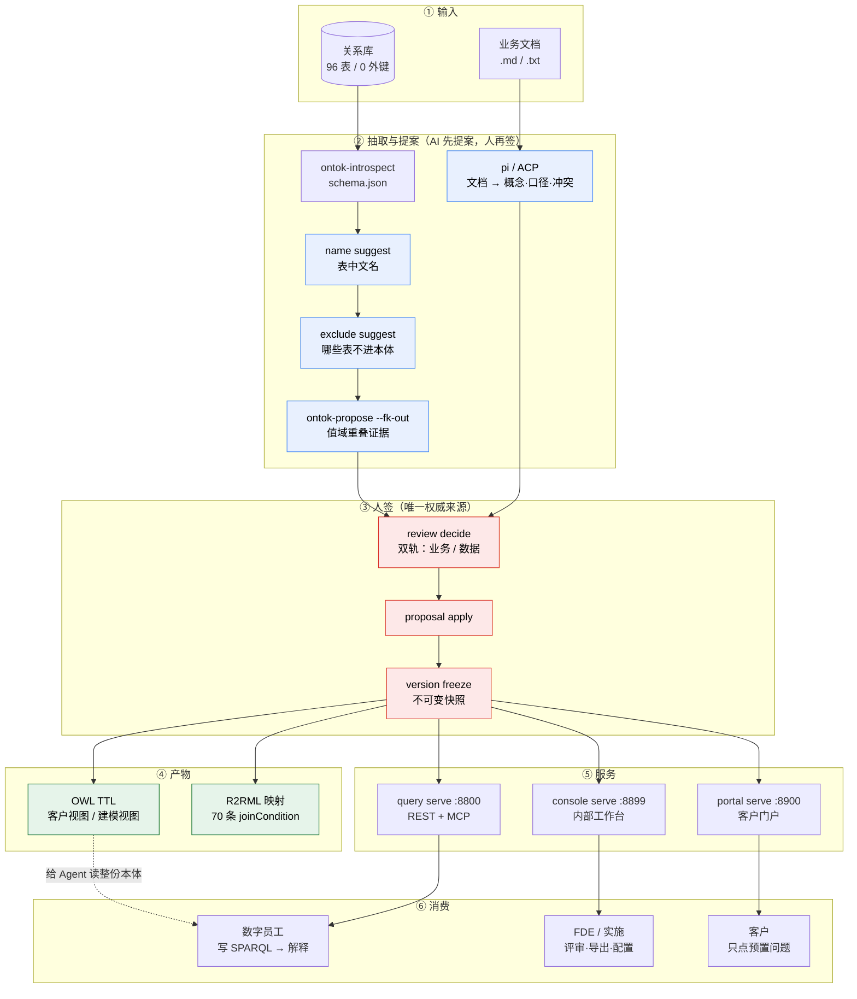

# 流程图 · 从库与文档到可查可问的本体

> 两条输入（**关系库** + **业务文档**）汇成本体，本体再落成两件产物（**TTL** 给人/Agent 读，**R2RML** 给 SQL 引擎用），
> 最后由三个服务把能力暴露给人、给客户、给数字员工。

---

## 一 · 主流程（Mermaid）

> 支持 Mermaid 的编辑器（GitHub / VS Code / Typora / Obsidian）可直接渲染；纯文本环境看第二节。



---

## 二 · ASCII 版（不依赖渲染器）

```
 ┌──────────────┐        ┌────────────────────┐
 │  关系库       │        │  业务文档 (.md/.txt)│
 │  96 表 / 0 FK │        │  计费·套餐·API·FAQ  │
 └──────┬───────┘        └─────────┬──────────┘
        │ introspect                │ pi / ACP（deepseek-v4.1-flash）
        ▼                           ▼
 ┌──────────────┐        ┌────────────────────┐
 │ schema.json  │        │ 文档抽取            │
 └──────┬───────┘        │ 概念·属性·关系      │
        │                │ 业务口径·冲突       │
        ▼                └─────────┬──────────┘
 ┌──────────────────────┐          │
 │ AI 提案（不权威）      │          │
 │ · 表中文名            │          │
 │ · 排除表              │          │
 │ · 关系 + 值域证据      │          │
 │   （true/inherit/false）│         │
 └──────────┬───────────┘          │
            └──────────┬───────────┘
                       ▼
            ┌────────────────────┐
            │  人签 review decide │  ← 唯一权威来源
            │  双轨：业务 / 数据   │
            └──────────┬─────────┘
                       ▼
            ┌────────────────────┐
            │ apply → freeze      │  不可变快照
            └──────────┬─────────┘
             ┌─────────┴──────────┐
             ▼                    ▼
    ┌─────────────────┐   ┌──────────────────┐
    │ OWL TTL          │   │ R2RML 映射        │
    │ 客户视图（无列名）│   │ 70 条 join       │
    │ 建模视图（全量）  │   │ false 边绝不生成  │
    └────────┬────────┘   └────────┬─────────┘
             │                     │
             ▼                     ▼
    ┌──────────────────────────────────────────┐
    │  query serve :8800    REST + MCP          │
    │  租户强制注入 · warnings/coverage          │
    ├──────────────────────────────────────────┤
    │  console serve :8899  内部工作台（页面）   │
    ├──────────────────────────────────────────┤
    │  portal serve :8900   客户门户（预置问题） │
    └────────┬──────────────┬─────────────┬────┘
             ▼              ▼             ▼
        数字员工          FDE/实施        客户
      （写 SPARQL）    （评审·导出）   （点卡片）
```

---

## 三 · 每个阶段的「判据」（不是"做完了"，是"守住了"）

| 阶段 | 关键判据 | 失败会怎样 |
| --- | --- | --- |
| 抽取 | 每条证据能在文档里**逐字定位** | 编造概念进本体 |
| 关系 | 值域重叠实测；`false` 边**永不进 R2RML** | 连错表但查得出数 |
| 评审 | 未签提案**不进快照** | AI 的猜测变事实 |
| 冻结 | 版本**不可变**，导出带 sha256 | 无法回溯"客户看到的是哪版" |
| TTL | 客户视图 `tenant*`/`primaryKey`/`allowedValue` **0 命中** | 内部结构泄漏给客户 |
| R2RML | 与 schema **对账 0 失败** | 映射到不存在的列 |
| 查询 | 两租户对拍**交集 0**；注入条件在 `sql_echo` 里可见 | 跨租户数据泄漏 |
| 门户 | 租户**只来自口令**；只给预审过的问题 | 客户乱查/看别人数据 |

---

## 四 · 三个入口，三套凭证（别混）

| 入口 | 凭证 | 能做什么 | 不能做什么 |
| --- | --- | --- | --- |
| `query serve` | query token（绑租户） | 写 SPARQL、取 catalog/describe、下载 TTL | 切换租户、写 |
| `console serve` | admin token | 评审、应用、冻结、导出、改声明、看审计 | 绕过评审直接改本体 |
| `portal serve` | portal token（绑租户） | 点预置问题 | 写 SPARQL、切租户、任何写操作 |

**三套 token 的 `kind` 互斥**：拿 admin token 调 query 服务 ⇒ 401，反之亦然。

---

## 五 · 一条业务数据是怎么被查到的

```
客户问「我这个月扣了多少钱」
        │
        ▼
数字员工：catalog → 找到 deductions 类与它的属性
        │
        ▼
数字员工写 SPARQL（不写租户条件——服务端会注入）
        │
        ▼
query serve：SPARQL → 按 R2RML 展开 SQL → 注入租户 → 只读执行
        │
        ▼
回执：rows + warnings + coverage + join_states + truncated
        │
        ▼
数字员工解释（必须转达：「这个数只覆盖主账号」）
        │
        ▼
客户看到答案 + 限定条件
```

**关键点**：`warnings` 不是装饰。`deductions` 表声明为 `main_only`，漏掉子账号的扣费——
**不转达这句话，答案就是错的**，而且是"看起来对"的错。
